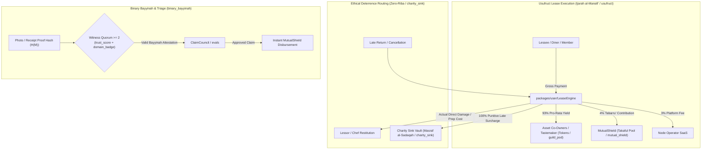

<div align="center">
  <h1>Muabase</h1>
  <p><strong>The Serverless Full-Stack Operating System for RWAs, High-Trust Marketplaces, and Trade Guilds</strong></p>
  <p>
    <em>Built on the Psibase Wasm-in-Database Architecture &bull; Governed by Invariant Mathematical Fiqh al-Mu‘amalat</em>
  </p>
  <p>
    &bull;
    <a href="#overview">Overview</a> &bull;
    <a href="#core-capabilities">Capabilities</a> &bull;
    <a href="#fiqh-invariants">Fiqh Invariants</a> &bull;
    <a href="#dual-locale-terminology">Dual Locale</a> &bull;
    <a href="#architecture">Architecture</a> &bull;
    <a href="#regulatory-safe-harbor">Regulatory Compliance</a> &bull;
    <a href="#headless-commerce-quickstart">Headless Quickstart</a> &bull;
    <a href="#build-from-source">Build & Run</a> &bull;
  </p>
</div>

---

## Overview

**Muabase** is a specialized fork of the `psibase` protocol engineered to serve as a high-performance, serverless operating system for:
1. **Family Offices & Private Syndicates:** Managing multi-jurisdictional asset portfolios, private Series LLCs, and multi-generational generational trusts with hardcoded capital-preservation policies (`endowment_policy` / **Trust Principal Preservation Lock** / *Hifz Asl al-Waqf*).
2. **Real-World Asset (RWA) Tokenization (Chintai Parity):** Compliant fractionalization of tangible physical assets (`asset_pool` / **RWA Asset Series & Series LLC** / *Sukuk al-Qirad & Musharakah*) with native Ricardian contract bindings, transfer restrictions, Right of First Refusal pre-emption (`priority_window` / **Co-Owner Right of First Refusal** / *Haqq al-Shuf‘ah*), and secondary market debt-protection floors (`tangible_ratio` / **Tangible Asset Backing Ratio >= 51%** / *Nisbat al-‘Ayn al-Haqiqiyyah*).
3. **High-Trust P2P Rental & Lending Guilds:** Headless commerce infrastructure outcompeting rent-extracting legacy platforms (e.g., peer-to-peer designer fashion rentals outcompeting apps like Pickle by delivering **93%+ take-home yield** to lenders vs. industry standard ~80%) via fixed usufruct leases (`usufruct` / **Fixed Usufruct Lease** / *Ijarah al-A‘yan wa al-Manafi‘*), automated multi-party splits (`external_vault` / **Non-Custodial Multi-Chain Splits** / *Amanah Ghayr Hiyaziyyah*), co-owned mutual damage pools (`mutual_shield` / **Mutual Protection Reserve Pool** / *Takaful*), and 3-peer evidence triage (`claim_council` / **Peer Triage Committee** / *Majlis al-Tahkim*).
4. **B2B Trade Cooperatives & Merchant Guilds:** Multi-lateral invoice netting (`credit_clear` / **Multilateral Invoice Netting** / *Muqassah*) and inter-chain trust graph credit routing (`wajahah_hawalah` / **Earned-Respect Liquidity Bridge** / *Wajahah & Hawalah*) eliminating liquidity fragmentation and predatory working-capital factoring.
5. **Social Tastemaker & Dining Discovery Guilds:** Un-gameable social restaurant tracking and ranking apps outcompeting Web2 incumbents like Beli through cryptographic proof-of-visit (`binary_bayyinah` / **Dual-Witness Evidentiary Gate** / *Bayyinah* receipt hashing), **93%+ tastemaker monetization** (`guild_pod` / **Cooperative Pod & Review Circle** / *Halaqat al-Tijarah*), and Wasm-native Condorcet pairwise tournaments (`evals` / **Objective Bounty & Claim Ranking** / *Ju‘alah Halaqa*).

All protocol logic executes directly in WebAssembly inside the `Triedent` memory-mapped transactional state storage, combining the developer ergonomics and microsecond latency of **SpacetimeDB** with high-throughput Byzantine fault-tolerant consensus.

---

## Core Capabilities Matrix

| Capability | Canonical Key | Institutional Locale (`"institutional"`) | Jurisprudential Locale (`"muamalat"`) | Legacy Web2 / Web3 Stack | Muabase Native Advantage |
| :--- | :--- | :--- | :--- | :--- | :--- |
| **Execution Latency** | `psinode` / `Triedent` | **Wasm-in-Database Execution Engine** | *Mahattat al-Wasm al-Mubashirah* | 1–15s RPC latency, external indexers, centralized API middleware | **Sub-millisecond Wasm-in-Database** running directly on `Triedent`. Built-in GraphQL and reactive SSE event streams. |
| **P2P Rental Economics** | `usufruct` | **Fixed Usufruct Lease / P2P Rental** | *Ijarah al-A‘yan wa al-Manafi‘* | Platforms extract 20%–35% take-rate with opaque dispute processes | **93%+ Lender Payout:** Transparent on-chain fee split (93% asset owner, 4% mutual shield pool, 3% SaaS operator). |
| **Damage Protection** | `mutual_shield` | **Mutual Protection Reserve Pool** | *Takaful (Tabarru‘ & Ta‘awun)* | High insurance markups, slow claim denials by centralized adjusters | **Member-Owned Mutual Pool:** User-contributed reserve pool with fast 3-peer evidence triage and annual underwriting surplus rebates (*Faid*). |
| **Dispute Resolution** | `claim_council` & `binary_bayyinah` | **Peer Triage Committee & Dual Witness Gate** | *Majlis al-Tahkim & Bayyinah* | Centralized claim adjusters, slow black-box ticket systems | **3-Peer Rapid Triage:** 2-witness quorum verifies cryptographic photo/receipt hashes before instant reserve disbursement. |
| **Asset Co-Ownership** | `asset_pool` & `priority_window` | **RWA Series LLC & Co-Owner Pre-emption** | *Sukuk al-Qirad & Haqq al-Shuf‘ah* | Expensive legal SPVs, fragmented entities, investor dilution | **Fractional Co-Buying (`Tokens` + `Nft`):** Automated pro-rata rental yield distribution and 24h Right of First Refusal window. |
| **Secondary Parity Floor** | `tangible_ratio` | **Tangible Asset Backing Ratio (>= 51%)** | *Nisbat al-‘Ayn al-Haqiqiyyah* | Naked debt speculation, unbacked tokens, discounted debt dumping | **Par-Value Trading Floor:** Secondary market trading halted if tangible physical backing drops below 51%, barring predatory debt trading (*Bay‘ al-Dayn*). |
| **Objective Curation & Ranking** | `evals` | **Objective Bounty & Claim Ranking** | *Ju‘alah Halaqa* | Black-box algorithms, pay-to-play sponsored rankings, popularity contests | **Condorcet Tournaments:** Un-gameable pairwise ranking in Wasm. People are never ranked; only verified work, restaurants, and claims are evaluated. |
| **Custodial & Regulatory Risk** | `external_vault` | **Non-Custodial Multi-Chain Vault & Splits** | *Amanah Ghayr Hiyaziyyah* | Centralized hot wallets, platform custody of user funds | **100% Non-Custodial:** Native Bitcoin Taproot Miniscript, EVM Safe, and Stripe Connect multiparty direct splits. Operators hold **0 keys**. Safe harbor under NYDFS BitLicense `23 NYCRR § 200.2(q)`. |
| **Sybil Resistance & Identity** | `trust_score` & `domain_badge` | **Reliability Score & Domain Competence Credential** | *‘Adalah & Ikhtisas* | Tradable speculative tokens, plutocratic voting, bot review farms | **Proof-of-Amanah:** Soulbound, non-transferable reputation records tied to cryptographic keys. Zero native speculative token. |
| **B2B Clearing & Credit** | `credit_clear` & `wajahah_hawalah` | **Multilateral Invoice Netting & Liquidity Bridge** | *Muqassah & Wajahah-Hawalah* | Fragmented banking rails, predatory factoring fees (2-5% per invoice) | **Automated Zero-Fee Netting:** Algorithmic debt cancellation and earned-trust liquidity routing without intermediate bank debt. |
| **Endowment & Capital Preservation** | `endowment_policy` | **Trust Principal Preservation Lock** | *Hifz Asl al-Waqf* | Fragile corporate bylaws, risk of managerial principal drawdown | **Mathematical Capital Preservation:** Outward capital transfers from principal accounts are rejected at state transition; only productive yield (*Manfa‘ah*) flows. |
| **Late Penalty Ethics** | `charity_sink` | **Public Endowment Charity Sink** | *Masraf al-Sadaqah* | Platforms and lenders profit from predatory late fees and borrower distress | **Zero-*Riba* Restitution:** Actual direct losses reimbursed to injured party; 100% of punitive deterrences hard-routed to a community charity sink vault. |

---

## Hardcoded *Fiqh al-Mu‘amalat* Invariants

Muabase embeds classical jurisprudence constraints directly into state transition logic:



1. **Zero-*Riba* Late-Fee Routing (`charity_sink` / Public Endowment Charity Sink / *Masraf al-Sadaqah*):** Creditors, lenders, lessors, and booking platforms can never profit from time-value late penalties or guest distress. In `LeaseEngine` and `TokenStream`, punitive late deterrences are mathematically hard-routed to a designated `charity_sink` public endowment vault (Wasm: `charity_sink_account`).
2. **Elimination of Subjective People-Ranking (`evals` / Objective Bounty & Claim Ranking / *Ju‘alah Halaqa*):** `Fractals`, `FractalCore`, and `FractalTester` are deprecated from the active build. Humans are never subjected to popularity contests or vanity follower algorithms. `evals`, `Guilds`, and `Subgroups` exclusively rank objective, verified work items (`ClaimId`, `BountyId`, `RestaurantRankBallot`, `DealProposalId`) via Wasm-native Schulze Condorcet tournaments.
3. **Binary *Bayyinah* Dual-Witness Gate (`binary_bayyinah` / Dual-Witness Evidentiary Gate / *Bayyinah*):** Prior to entering dispute triage or releasing escrow in `StagedTx`, at least 2 qualified witnesses (`witness_quorum >= 2`) holding verified `trust_score` (Reliability Score / `AdalahScore`) and `domain_badge` (Domain Competence Credential / `IkhtisasTag`) credentials must co-sign the Ricardian evidence digest.
4. **Tangible Asset Floor (`tangible_ratio` / Tangible Asset Backing Ratio / *Nisbat al-‘Ayn al-Haqiqiyyah* >= 51%):** Secondary market trading of RWA tokens above or below par value is strictly gated in `TokenSwap`. When tangible asset backing (*‘Ayn*) falls below 51% (`tangible_ratio_bps < 5100`), secondary trading at non-par is halted to prevent naked debt speculation (*Bay‘ al-Dayn*).
5. **Right of First Refusal (*Haqq al-Shuf‘ah* / `priority_window` / Co-Owner Pre-emption Window):** When fractional co-owners list an asset share for sale, existing co-owners enjoy an automated exclusive pre-emption window (`priority_window_sec`, default 86,400s / 24h) before units can be purchased by outside investors.
6. **Immutable Endowment Guard (`endowment_policy` / Trust Principal Preservation Lock / *Hifz Asl al-Waqf*):** Accounts tagged as trust principal (*Waqf Asl*) reject outward capital consumption transfers via `endowment_policy` (`EndowmentGuard`); principal is locked to productive investments, while 100% of generated yield flows into a dedicated distributable account (*Manfa‘ah*).
7. **Multilateral Invoice Netting & Earned-Trust Routing (`credit_clear` & `wajahah_hawalah` / Multilateral Invoice Netting & Liquidity Bridge / *Muqassah & Wajahah-Hawalah*):** Bilateral and cyclic multi-party B2B invoices are algorithmically netted without cash transfers, while trade credit routes across verified trust graphs without debt monetization.
8. **Zero-Custody Trustee Escrow (`external_vault` / Non-Custodial Multi-Chain Splits / *Amanah Ghayr Hiyaziyyah*):** Protocol maintaining entities hold zero custody over fiat or digital assets. Escrow and payments resolve via client-side multisig (Bitcoin Taproot Miniscript, EVM Safe, Solana Squads) or automated Stripe Connect destination splits, qualifying under the NYDFS BitLicense pure software safe harbor (`23 NYCRR § 200.2(q)`).

---

## Dual-Locale Terminology Switching

Muabase provides an on-chain locale engine in `packages/user/Branding` so interfaces and developer tools can switch seamlessly between standard institutional terminology and classical jurisprudence terms:

| Canonical Key (`key`) | Institutional Locale (`"institutional"`) | Jurisprudential Locale (`"muamalat"`) | Classical Legal Basis & Jurisprudential Invariant |
| :--- | :--- | :--- | :--- |
| `asset_pool` | RWA Asset Series / Series LLC | *Sukuk al-Qirad / Musharakah* | Fractional co-ownership of real physical assets (*A‘yan*) with shared profit and liability. |
| `usufruct` | Fixed Usufruct Lease / P2P Rental | *Ijarah al-A‘yan wa al-Manafi‘* | Separation of asset ownership from temporary right-of-use (*Manfa‘ah*). |
| `equity_lease` | Progressive Lease-to-Own / Equity Lease | *Musharakah Mutanaqisah* | Gradual transfer of fractional asset equity alongside decreasing rental installments. |
| `mutual_shield` | Mutual Protection Reserve Pool | *Takaful (Tabarru‘ & Ta‘awun)* | Non-profit risk pooling based on gratuitous contribution (*Tabarru‘*) with pro-rata surplus return (*Faid*). |
| `claim_council` | Peer Triage Committee | *Majlis al-Tahkim & Shura* | Impartial arbitration by qualified, reliable peers (*Hakam*) based on tangible evidence (*Bayyinah*). |
| `evals` | Objective Bounty & Claim Ranking | *Ju‘alah Halaqa* | Performance-based compensation for verified work items, ranked via objective Condorcet criteria. |
| `endowment_policy` | Trust Principal Preservation Lock | *Hifz Asl al-Waqf* | Strict preservation of principal corpus (*Asl*) while allowing only productive yield (*Manfa‘ah*) to flow. |
| `priority_window` | Co-Owner Right of First Refusal | *Haqq al-Shuf‘ah* | Mandatory exclusive pre-emption window for existing fractional co-owners before external offering. |
| `charity_sink` | Public Endowment Charity Sink | *Masraf al-Sadaqah* | Absolute zero-creditor-enrichment rule: punitive late fees are routed to charitable public utility. |
| `credit_clear` | Multilateral Invoice Netting | *Muqassah* | Debt set-off between reciprocal trading partners to extinguish obligations without cash transfers. |
| `wajahah_hawalah` | Earned-Respect Liquidity Bridge | *Wajahah & Hawalah* | Novation and debt assignment backed by commercial goodwill, reputation (*Wajahah*), and collateral. |
| `trust_score` | Reliability & Audit Score | *‘Adalah (Probity / Reliability)* | Non-transferable track record of probity, contract fulfillment, and truthful witness testimony. |
| `domain_badge` | Domain Competence Credential | *Ikhtisas (Domain Specialization)* | Soulbound domain capability verification (e.g. sommelier, textile inspector, real estate appraiser). |
| `tangible_ratio` | Tangible Asset Backing Ratio (>= 51%) | *Nisbat al-‘Ayn al-Haqiqiyyah* | Mathematical floor enforcing >= 51% tangible asset/usufruct backing to prevent naked debt trading (`tangible_ratio_bps >= 5100`). |
| `binary_bayyinah` | Dual-Witness Evidentiary Gate | *Bayyinah (Dual Proof / Attestation)* | 2-witness quorum verification of physical evidence digests (receipt hashes, condition photos) prior to escrow or claim release. |
| `external_vault` | Non-Custodial Multi-Chain Splits | *Amanah Ghayr Hiyaziyyah (Trustee Escrow)* | 0-key client-side execution on Stripe Connect, EVM Safe, and Bitcoin Taproot Miniscript, eliminating platform custody liability. |
| `guild_pod` | Cooperative Pod & Review Circle | *Halaqat al-Tijarah / al-Shura* | Autonomous 5-7 peer governance pods operating consensus without centralized managerial capture. |

---

## NYC BitLicense & Martin Act Regulatory Safe Harbor

Muabase is explicitly designed to operate under the **New York Department of Financial Services (NYDFS) BitLicense Pure Software Exemption (`23 NYCRR § 200.2(q)`)** and US Federal securities guidelines:

1. **Zero Native Speculative Utility Token:** The protocol has no native volatile gas or governance token. Transaction bandwidth and storage are managed directly via CPU time accounting and bonded capacity without secondary market speculation.
2. **Soulbound Non-Transferable Credentials:** Reputation scores (`trust_score` / `AdalahScore`) and verification credentials (`domain_badge` / `IkhtisasTag`) are strictly soulbound to account keys and cannot be transferred, sold, or borrowed.
3. **100% Non-Custodial Multi-Chain Signatures:** The core protocol never takes custody of fiat or digital currencies. All payments resolve either via client-side multi-party crypto primitives (Bitcoin Taproot Miniscript, EVM Safe, Solana Squads) or through direct enterprise payment splits (Stripe Connect multi-party webhooks). Software developers and infrastructure nodes hold **zero keys** to user capital.

---

## Headless Commerce Quickstart

Install the headless client SDK in your React / Next.js / React Native application:

```bash
npm install @muabase/headless-sdk
```

Connect directly to your local or hosted `psinode` without backend middleware:

```typescript
import { createMuabaseClient } from "@muabase/headless-sdk";

// Initialize client connecting to psinode Wasm database
const client = createMuabaseClient({
  endpoint: "https://my-node.muabase.org",
  locale: "institutional", // or "muamalat" for classical jurisprudence terminology
});

// =========================================================================
// Example A: P2P Luxury Rental Flow (Pickle Competitor)
// =========================================================================

// 1. List a luxury item or equipment into an asset_pool (Sukuk al-Qirad)
const asset = await client.guild.assets.create({
  title: "Designer Dress / Camera Kit",
  dayRateUsd: 45.0,
  replacementValueUsd: 1200.0,
  tangibleRatioBps: 10000,  // 100% tangible asset backing (tangible_ratio)
  priorityWindowSec: 86400, // 24h co-owner priority window (Haqq al-Shuf'ah)
});

// 2. Execute instant checkout with autonomous 93%/4%/3% split
const lease = await client.guild.leases.checkout({
  assetId: asset.id,
  durationDays: 4,
  preConditionEvidenceHash: "0x3a4b...photos", // Binary Bayyinah digest
});
// Gross payment splits autonomously:
// 93% -> Asset Owner, 4% -> Mutual Protection Pool (Takaful), 3% -> SaaS Operator

// 3. Complete return with condition sign-off
await client.guild.leases.confirmReturn({
  leaseId: lease.id,
  postConditionEvidenceHash: "0x9f1c...photos",
});

// =========================================================================
// Example B: Social Restaurant Tracking & Tastemaker Curation (Beli Competitor)
// =========================================================================

// 1. Log verified dining experience with cryptographic proof-of-visit (Bayyinah)
await client.dining.restaurants.submitProofOfVisit({
  restaurantId: 3001,
  receiptDigestHash: "0x8f2d...pos_receipt_sha256",
  visitTimestamp: Math.floor(Date.now() / 1000),
  overallRatingBps: 9200, // 9.20 / 10.0
  dishesOrdered: ["Hand-rolled Cavatelli", "Dry-aged Ribeye"],
});

// 2. Submit pairwise comparison into Wasm Condorcet tournament (evals)
await client.dining.rankings.recordComparison({
  winnerRestaurantId: 3001,
  loserRestaurantId: 2042,
  category: "food",
});
```

### Reference Implementation Guides
- **[High-Trust P2P Rental Marketplace (Pickle Competitor)](packages/shared-ui/headless-sdk/examples/fashion-guild-quickstart.md):** 93% take-home yield (`usufruct`), 4% mutual shield (`mutual_shield` / *Takaful*), 3% SaaS operator, zero-*riba* charity sink routing (`charity_sink` / *Masraf al-Sadaqah*).
- **[Un-Gameable Social Restaurant Ranking & Tastemaker App (Beli Competitor)](packages/shared-ui/headless-sdk/examples/beli-competitor-quickstart.md):** 93% tastemaker take-home, cryptographic proof-of-visit (`binary_bayyinah` / *Bayyinah* receipt hashing), Wasm-native Condorcet pairwise tournaments (`evals` / *Ju‘alah Halaqa*), non-custodial supper club escrow (`external_vault` / *Amanah Ghayr Hiyaziyyah*), and zero-*riba* food rescue sink (`charity_sink`).
- **[Real Estate & Solar Infrastructure Cooperative (MizanVest)](packages/shared-ui/headless-sdk/examples/mizanvest-quickstart.md):** Workforce housing & commercial solar syndication (`asset_pool` / *Musharakah*), Yield Stabilization Reserve (8–12% target payout), 100% tangible asset backing (`tangible_ratio` / *Nisbat al-‘Ayn*), and endowment principal lock (`endowment_policy` / *Hifz Asl al-Waqf*).
- **[Positive-Sum Ethical Forecasting Protocol (Irfan.Markets)](packages/shared-ui/headless-sdk/examples/irfan-markets-quickstart.md):** 100% principal protection, Ju‘alah knowledge bounties from redirected yield (`evals` / *Ju‘alah*), binary *Bayyinah* resolution gate (`binary_bayyinah`), and zero-house extraction charity sink (`charity_sink`).


---

## Repository Structure

```
├── packages/
│   ├── system/
│   │   ├── StagedTx/        # Ricardian contracts & dual-witness evidentiary gating
│   │   ├── AuthDelegate/    # Endowment (Waqf) principal locks & permission routing
│   │   ├── Credentials/     # Soulbound Adalah (reliability) & Ikhtisas (competence)
│   │   └── Producers/       # Consensus & Bitcoin/L2 state-root anchor checkpoints
│   ├── user/
│   │   ├── Branding/        # Dual-locale terminology dictionary and network branding
│   │   ├── Tokens/          # RWA series config, 51% tangible floor, investor caps
│   │   ├── Nft/             # Individual physical item tokenization & custody tracking
│   │   ├── TokenSwap/       # Par-value debt protection & Shuf'ah (ROFR) order books
│   │   ├── LeaseEngine/     # P2P rentals, progressive buyouts & zero-riba charity sink
│   │   ├── MutualShield/    # Takaful protection pool with epoch surplus rebates
│   │   ├── ClaimCouncil/    # 3-peer rapid damage triage & Halaqa Ju'alah bounty ranking
│   │   ├── CreditClear/     # Bilateral & multilateral B2B invoice netting (Muqassah)
│   │   ├── ExternalVault/   # Non-custodial Bitcoin Taproot, EVM Safe & Stripe splits
│   │   ├── Evaluations/     # Objective claim/bounty rank-ordering
│   │   ├── Guilds/          # Cooperative merchant pods & investment committees
│   │   └── Subgroups/       # 5-7 peer review pods (Halaqat)
│   └── shared-ui/
│       └── headless-sdk/    # Reactive TypeScript SDK (@muabase/headless-sdk)
├── doc/
│   └── MUABASE_SPEC.md      # Mathematical specification, formulas, & regulatory proofs
└── rust/
    └── psibase/             # Core Wasm-in-Database micro-execution engine
```

---

## Build from Source

### Prerequisites
- Ubuntu 22.04 / 24.04 / WSL2
- Clang 16+, CMake 3.22+, Make 4.3+
- Rust 1.98+ with `wasm32-wasip1` and `wasm32-unknown-unknown` targets
- Node.js 24+, Yarn 4+

### Compilation
```sh
git submodule update --init --recursive
mkdir build && cd build
cmake -DCMAKE_BUILD_TYPE=Release -DCMAKE_INSTALL_PREFIX=psidk ..
make -j $(nproc)
ctest -j $(nproc)
make install
```

---

## License

Muabase is released under the Apache 2.0 License.
