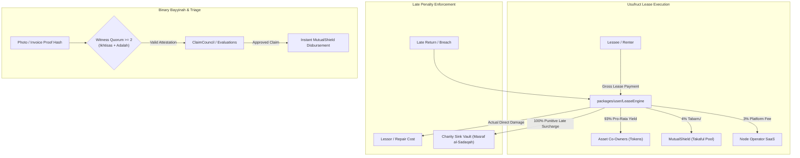

<div align="center">
  <h1>Muabase</h1>
  <p><strong>The Serverless Full-Stack Operating System for RWAs, High-Trust Marketplaces, and Trade Guilds</strong></p>
  <p>
    <em>Built on the Psibase Wasm-in-Database Architecture &bull; Governed by Invariant Mathematical Fiqh al-Mu‘amalat</em>
  </p>
  <p>
    &bull;
    <a href="#overview">Overview</a> &bull;
    <a href="#core-capabilities">Capabilities</a> &bull;
    <a href="#fiqh-invariants">Fiqh Invariants</a> &bull;
    <a href="#dual-locale-terminology">Dual Locale</a> &bull;
    <a href="#architecture">Architecture</a> &bull;
    <a href="#regulatory-safe-harbor">Regulatory Compliance</a> &bull;
    <a href="#headless-commerce-quickstart">Headless Quickstart</a> &bull;
    <a href="#build-from-source">Build & Run</a> &bull;
  </p>
</div>

---

## Overview

**Muabase** is a specialized fork of the `psibase` protocol engineered to serve as a high-performance, serverless operating system for:
1. **Family Offices & Private Syndicates:** Managing multi-jurisdictional asset portfolios, private Series LLCs, and multi-generational generational trusts (*Awqaf*) with hardcoded capital-preservation policies.
2. **Real-World Asset (RWA) Tokenization (Chintai Parity):** Compliant fractionalization of tangible physical assets (equipment, luxury fashion, commercial fleet, real estate) with native Ricardian contract bindings, transfer restrictions, and secondary market debt-protection floors.
3. **High-Trust P2P Rental & Lending Guilds:** Headless commerce infrastructure outcompeting rent-extracting legacy platforms (e.g., peer-to-peer designer fashion rentals outcompeting apps like Pickle by delivering **93%+ take-home yield** to lenders vs. industry standard ~80%), featuring autonomous multi-party revenue splits, co-owned mutual damage pools, and peer triage.
4. **B2B Trade Cooperatives & Merchant Guilds:** Multi-lateral invoice netting (*Muqassah*) and inter-chain trust graph credit routing (*Wajahah-Hawalah*) eliminating liquidity fragmentation and predatory working-capital financing.

All protocol logic executes directly in WebAssembly inside the `Triedent` memory-mapped transactional state storage, combining the developer ergonomics and microsecond latency of **SpacetimeDB** with high-throughput Byzantine fault-tolerant consensus.

---

## Core Capabilities

| Capability | Legacy Web2 / Web3 Stack | Muabase Native Architecture |
| :--- | :--- | :--- |
| **Execution Speed** | Layer 1/2 VM calls, external RPC nodes, indexing subgraphs (1-15s latency) | **Wasm-in-Database** running directly on `Triedent`. Sub-millisecond read/write speed with built-in GraphQL and reactive WebSocket event streams. |
| **P2P Rental Economics** | Platforms extract 20%–35% take-rate with opaque dispute processes | **93%+ Lender Payout:** Transparent on-chain fee split (3% protocol/infrastructure, 4% mutual shield pool, 93% asset owner/syndicate). |
| **Damage Protection** | High insurance markups, slow claim denials by centralized adjusters | **Mutual Protection Pool (*Takaful*):** User-contributed reserve pool with fast 3-peer evidence triage (*Tahkim*) and annual underwriting surplus rebates. |
| **Asset Co-Ownership** | Fragmented legal entities, expensive administrative SPVs | **Fractional Co-Buying (`Tokens` + `Nft`):** Co-owners pool capital to acquire high-yield assets, auto-split rental yields pro-rata, and exercise automated Right of First Refusal (*Shuf‘ah*). |
| **Custodial Risk** | Centralized hot wallets or platform bank accounts | **100% Non-Custodial (`ExternalVault`):** Native Bitcoin Taproot Miniscript PSBTs, EVM Safe, Solana Squads, and Stripe Connect multiparty direct splits. Operators hold **0 keys**. |
| **Governance / Sybil** | Tradable speculative tokens, plutocratic token-weighted voting | **Proof-of-Amanah:** Non-transferable, soulbound audit credentials (`Adalah`) and domain competence credentials (`Ikhtisas`). Zero native speculative token. |

---

## Hardcoded *Fiqh al-Mu‘amalat* Invariants

Muabase embeds classical jurisprudence constraints directly into state transition logic:



1. **Zero-*Riba* Late-Fee Routing (`charity_sink_account`):** Creditors, lenders, and lessors can never profit from time-value late penalties. In `LeaseEngine` and `TokenStream`, punitive late deterrences are mathematically hard-routed to a designated public endowment vault (*Sadaqah*).
2. **Elimination of Subjective People-Ranking:** `Fractals`, `FractalCore`, and `FractalTester` are deprecated from the active build. Humans are never subjected to popularity contests. `Evaluations`, `Guilds`, and `Subgroups` exclusively rank objective, verified work items (`ClaimId`, `BountyId`, `DealProposalId`).
3. **Binary *Bayyinah* (Dual-Witness Gate):** Prior to entering dispute triage or releasing escrow in `StagedTx`, at least 2 qualified witnesses (`witness_quorum >= 2`) holding verified `Adalah` (reliability) and `Ikhtisas` (competence) credentials must co-sign the Ricardian evidence hash.
4. **Tangible Asset Floor (`tangible_ratio_bps >= 5100`):** Secondary market trading of RWA tokens above or below par value is strictly gated in `TokenSwap`. When tangible asset backing (*‘Ayn*) falls below 51%, secondary trading at non-par is halted to prevent naked debt speculation (*Bay‘ al-Dayn*).
5. **Right of First Refusal (*Haqq al-Shuf‘ah*):** When fractional co-owners list their share of an asset, existing co-owners enjoy an automated `rofr_window_sec` exclusive purchase window before units can be acquired by external parties.
6. **Immutable Endowment Guard (`EndowmentPolicy`):** Accounts tagged as trust principal (*Waqf Asl*) reject outward capital consumption transfers; principal is restricted to approved productive investments, while 100% of generated yield flows into a dedicated distributable account (*Manfa‘ah*).

---

## Dual-Locale Terminology Switching

Muabase provides an on-chain locale engine in `packages/user/Branding` so interfaces and developer tools can switch seamlessly between standard institutional terminology and classical jurisprudence terms:

| Canonical Entity / Concept | Institutional Locale (`"institutional"`) | Jurisprudence Locale (`"muamalat"`) |
| :--- | :--- | :--- |
| `RwaSeriesConfig` | Asset Token Series / Private LLC | *Sukuk al-Qirad / Musharakah* |
| `UsufructLease` (Short-Term) | P2P Peer Rental / Usufruct Lease | *Ijarah al-A‘yan wa al-Manafi‘* |
| `UsufructLease` (Progressive) | Progressive Lease-to-Own | *Musharakah Mutanaqisah* |
| `MutualShield` | Mutual Protection Reserve Pool | *Takaful (Tabarru‘ & Ta‘awun)* |
| `ClaimCouncil` | Peer Triage & Audit Committee | *Majlis al-Tahkim & Shura* |
| `evals` | Objective Bounty / Claim Ranking | *Ju‘alah Halaqa* |
| `EndowmentPolicy` | Trust Principal Preservation Guard | *Hifz Asl al-Waqf* |
| `rofr_window_sec` | Co-Owner Right of First Refusal | *Haqq al-Shuf‘ah* |
| `charity_sink_account` | Public Endowment Charity Sink | *Masraf al-Sadaqah* |
| `CreditClear` | Multilateral Invoice Clearing | *Muqassah & Wajahah-Hawalah* |
| `trust_score` | Reliability & Audit Score | *‘Adalah (Reliability)* |
| `domain_badge` | Domain Competence Badge | *Ikhtisas (Specialization)* |
| `tangible_ratio_bps` | Real Tangible Asset Backing Ratio | *Nisbat al-‘Ayn al-Haqiqiyyah* |

---

## NYC BitLicense & Martin Act Regulatory Safe Harbor

Muabase is explicitly designed to operate under the **New York Department of Financial Services (NYDFS) BitLicense Pure Software Exemption (`23 NYCRR § 200.2(q)`)** and US Federal securities guidelines:

1. **Zero Native Speculative Utility Token:** The protocol has no native volatile gas or governance token. Transaction bandwidth and storage are managed directly via CPU time accounting and bonded capacity without secondary market speculation.
2. **Soulbound Non-Transferable Credentials:** Reputation scores (`AdalahScore`) and verification credentials (`IkhtisasTag`) are strictly soulbound to account keys and cannot be transferred, sold, or borrowed.
3. **100% Non-Custodial Multi-Chain Signatures:** The core protocol never takes custody of fiat or digital currencies. All payments resolve either via client-side multi-party crypto primitives (Bitcoin Taproot Miniscript, EVM Safe, Solana Squads) or through direct enterprise payment splits (Stripe Connect multi-party webhooks). Software developers and infrastructure nodes hold **zero keys** to user capital.

---

## Headless Commerce Quickstart

Install the headless client SDK in your React / Next.js / React Native application:

```bash
npm install @muabase/headless-sdk
```

Connect directly to your local or hosted `psinode` without backend middleware:

```typescript
import { createMuabaseClient } from "@muabase/headless-sdk";

// Initialize client connecting to psinode Wasm database
const client = createMuabaseClient({
  endpoint: "https://my-node.muabase.org",
  locale: "institutional", // or "muamalat"
});

// 1. List a luxury item or equipment for P2P rental
const asset = await client.guild.assets.create({
  title: "Designer Dress / Camera Kit",
  dayRateUsd: 45.0,
  replacementValueUsd: 1200.0,
  tangibleRatioBps: 10000, // 100% tangible
  rofrWindowSec: 86400,     // 24hr co-owner priority
});

// 2. Execute instant checkout with multi-party split
const lease = await client.guild.leases.checkout({
  assetId: asset.id,
  durationDays: 4,
  preConditionEvidenceHash: "0x3a4b...photos",
});
// Gross payment is automatically split:
// 93% -> Owner, 4% -> Mutual Protection Pool, 3% -> SaaS Operator

// 3. Complete return with condition sign-off
await client.guild.leases.confirmReturn({
  leaseId: lease.id,
  postConditionEvidenceHash: "0x9f1c...photos",
});
```

---

## Repository Structure

```
├── packages/
│   ├── system/
│   │   ├── StagedTx/        # Ricardian contracts & dual-witness evidentiary gating
│   │   ├── AuthDelegate/    # Endowment (Waqf) principal locks & permission routing
│   │   ├── Credentials/     # Soulbound Adalah (reliability) & Ikhtisas (competence)
│   │   └── Producers/       # Consensus & Bitcoin/L2 state-root anchor checkpoints
│   ├── user/
│   │   ├── Branding/        # Dual-locale terminology dictionary and network branding
│   │   ├── Tokens/          # RWA series config, 51% tangible floor, investor caps
│   │   ├── Nft/             # Individual physical item tokenization & custody tracking
│   │   ├── TokenSwap/       # Par-value debt protection & Shuf'ah (ROFR) order books
│   │   ├── LeaseEngine/     # P2P rentals, progressive buyouts & zero-riba charity sink
│   │   ├── MutualShield/    # Takaful protection pool with epoch surplus rebates
│   │   ├── ClaimCouncil/    # 3-peer rapid damage triage & Halaqa Ju'alah bounty ranking
│   │   ├── CreditClear/     # Bilateral & multilateral B2B invoice netting (Muqassah)
│   │   ├── ExternalVault/   # Non-custodial Bitcoin Taproot, EVM Safe & Stripe splits
│   │   ├── Evaluations/     # Objective claim/bounty rank-ordering
│   │   ├── Guilds/          # Cooperative merchant pods & investment committees
│   │   └── Subgroups/       # 5-7 peer review pods (Halaqat)
│   └── shared-ui/
│       └── headless-sdk/    # Reactive TypeScript SDK (@muabase/headless-sdk)
├── doc/
│   └── MUABASE_SPEC.md      # Mathematical specification, formulas, & regulatory proofs
└── rust/
    └── psibase/             # Core Wasm-in-Database micro-execution engine
```

---

## Build from Source

### Prerequisites
- Ubuntu 22.04 / 24.04 / WSL2
- Clang 16+, CMake 3.22+, Make 4.3+
- Rust 1.98+ with `wasm32-wasip1` and `wasm32-unknown-unknown` targets
- Node.js 24+, Yarn 4+

### Compilation
```sh
git submodule update --init --recursive
mkdir build && cd build
cmake -DCMAKE_BUILD_TYPE=Release -DCMAKE_INSTALL_PREFIX=psidk ..
make -j $(nproc)
ctest -j $(nproc)
make install
```

---

## License

Muabase is released under the Apache 2.0 License.
