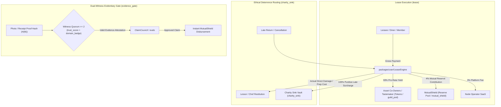

<div align="center">
  <h1>Muabase</h1>
  <p><strong>The Real-Time Wasm Operating System for High-Trust Digital Commerce</strong></p>
  <p>
    <em>Sub-Millisecond Wasm-in-Database Speed &bull; Zero Backend Middleware &bull; Governed by Invariant Commercial Law & Mathematical Ethics</em>
  </p>
  <p>
    &bull;
    <a href="#overview">Overview</a> &bull;
    <a href="#core-capabilities-matrix">Capabilities Matrix</a> &bull;
    <a href="#hardcoded-commercial-invariants">Commercial Invariants</a> &bull;
    <a href="#institutional-architecture">Core Architecture</a> &bull;
    <a href="#regulatory-safe-harbor">Regulatory Compliance</a> &bull;
    <a href="compliance.md">Ethical & Shariah Compliance</a> &bull;
    <a href="#headless-commerce-quickstart">Headless Quickstart</a> &bull;
    <a href="#reference-guides">Reference Guides</a> &bull;
    <a href="#build-from-source">Build & Run</a> &bull;
  </p>
</div>

---

## Overview

**Muabase** is a serverless, real-time transactional database and application engine designed to replace the entire legacy backend stack (PostgreSQL + Redis + GraphQL servers + Auth microservices) and slow, speculative smart-contract blockchains with a single, high-performance architecture.

Executing WebAssembly directly inside memory-mapped Trie storage (`Triedent`), Muabase pairs the developer ergonomics, sub-millisecond query latency, and reactive subscriptions of **SpacetimeDB** with high-throughput Byzantine fault-tolerant consensus and the invariant mathematical constraints of equitable commercial law, fair risk sharing, and non-extractive exchange. (For full Shariah and classical Islamic jurisprudence compliance specifications, see [compliance.md](compliance.md).)

### The Broken Status Quo: Extractive Web2 vs. Speculative Web3

Modern applications requiring trust, peer-to-peer commerce, verified reviews, or multi-party revenue distribution are trapped between two broken paradigms:

1. **Legacy Web2 is Extractive, Opaque, and Fragile:** Centralized incumbents (marketplaces, review apps, rental platforms, discovery networks) operate as rent-seeking middlemen. They extract 20%–35% take-rates, trap user data in proprietary walled gardens, manipulate rankings with pay-to-play advertising, and expose operators to severe custodial liabilities. Meanwhile, building these apps requires stitching together brittle database clusters, caches, and sync engines costing thousands of dollars a month before acquiring a single user.
2. **Traditional Web3 is Slow, Costly, and Casino-Like:** Smart contract platforms suffer from 1–15 second RPC latency, brittle indexing subgraphs, volatile gas spikes, and speculative governance tokens that attract regulatory scrutiny rather than authentic commercial utility.

### The Muabase Solution: Universal Invariant Commercial Infrastructure

Muabase provides a developer-first alternative: a single, high-performance database where **commercial ethics, non-custodial payouts, and evidentiary verification are hardcoded directly into state transition logic**. 

Frontends (Next.js, Vite, React Native) connect directly to `psinode` nodes without intermediate backend servers, querying data with microsecond latency and subscribing to live tables via reactive Server-Sent Events (`useMuabaseTable`).

Instead of rigid, vertical-specific backends, Muabase equips developers with **universal canonical primitives**:
- **93%+ Take-Home Yields (`lease`):** Slashes platform take-rates down to a 3% SaaS fee, passing 93% directly to creators, lenders, and asset owners, with 4% routed to member-owned mutual protection reserve pools (`mutual_shield`).
- **Cryptographic Evidentiary Verification (`evidence_gate`):** Eliminates bot astroturfing and review fraud by gating disputes and attestations behind 2-witness quorums verifying Ricardian photo or receipt hashes co-signed by soulbound domain credentials (`domain_badge`) and reliability scores (`trust_score`).
- **Objective Condorcet Ranking (`evals`):** Eliminates subjective popularity contests and pay-to-play algorithms. Arbitrary entities (restaurants, damage claims, development bounties) are ranked via un-gameable Schulze Condorcet tournaments directly in WebAssembly.
- **100% Non-Custodial Multi-Chain Execution (`external_vault`):** Zero operator keys or custody of funds. Payments settle via client-side multisig (Bitcoin Taproot Miniscript, EVM Safe, Solana Squads) or automated Stripe Connect destination splits, safely operating under the NYDFS BitLicense pure software exemption (`23 NYCRR § 200.2(q)`).
- **Zero-Penalty Profiteering Restitution (`charity_sink`):** Punitive late fees or guest cancellation deterrents never line the platform's or creditor's pockets; direct proven costs are reimbursed to the injured party, while punitive surcharges route 100% to a community public endowment charity sink.
- **Tangible Parity Floors (`tangible_ratio` >= 51%):** Secondary market trading of real-world asset shares at non-par is mathematically halted if physical backing falls below 51%, preventing naked debt speculation and discounted debt dumping.
- **Capital Preservation Guards (`endowment_policy`):** Trust principal accounts reject outward capital consumption transfers, ensuring principal remains locked in productive assets while generated yield flows to beneficiaries.

Whether building a peer-to-peer luxury rental platform, an un-gameable social restaurant ranking app, a real estate cooperative, or a multilateral B2B clearinghouse, builders compose these same universal primitives on the client.

---

## Core Capabilities Matrix

| Capability | Canonical Key | Professional Primitive | Legacy Web2 / Web3 Stack | Muabase Native Advantage |
| :--- | :--- | :--- | :--- | :--- |
| **Execution Latency** | `psinode` / `Triedent` | **Wasm-in-Database Execution Engine** | 1–15s RPC latency, external indexers, centralized API middleware | **Sub-millisecond Wasm-in-Database** running directly on `Triedent`. Built-in GraphQL and reactive SSE event streams. |
| **P2P Rental Economics** | `lease` | **Fixed Lease / P2P Rental** | Platforms extract 20%–35% take-rate with opaque dispute processes | **93%+ Lender Payout:** Transparent on-chain fee split (93% asset owner, 4% mutual shield pool, 3% SaaS operator). |
| **Damage Protection** | `mutual_shield` | **Mutual Protection Reserve Pool** | High insurance markups, slow claim denials by centralized adjusters | **Member-Owned Mutual Pool:** User-contributed reserve pool with fast 3-peer evidence triage and annual underwriting surplus rebates. |
| **Dispute Resolution** | `claim_council` & `evidence_gate` | **Peer Triage Committee & Dual-Witness Gate** | Centralized claim adjusters, slow black-box ticket systems | **3-Peer Rapid Triage:** 2-witness quorum verifies cryptographic photo/receipt hashes before instant reserve disbursement. |
| **Asset Co-Ownership** | `asset_pool` & `priority_window` | **RWA Series LLC & Co-Owner Pre-emption** | Expensive legal SPVs, fragmented entities, investor dilution | **Fractional Co-Buying (`Tokens` + `Nft`):** Automated pro-rata rental yield distribution and 24h Right of First Refusal window. |
| **Secondary Parity Floor** | `tangible_ratio` | **Tangible Asset Backing Ratio (>= 51%)** | Naked debt speculation, unbacked tokens, discounted debt dumping | **Par-Value Trading Floor:** Secondary market trading halted if tangible physical backing drops below 51%, barring predatory debt trading. |
| **Objective Curation & Ranking** | `evals` | **Objective Bounty & Claim Ranking** | Black-box algorithms, pay-to-play sponsored rankings, popularity contests | **Condorcet Tournaments:** Un-gameable pairwise ranking in Wasm. People are never ranked; only verified work, restaurants, and claims are evaluated. |
| **Custodial & Regulatory Risk** | `external_vault` | **Non-Custodial Multi-Chain Vault & Splits** | Centralized hot wallets, platform custody of user funds | **100% Non-Custodial:** Native Bitcoin Taproot Miniscript, EVM Safe, and Stripe Connect multiparty direct splits. Operators hold **0 keys**. Safe harbor under NYDFS BitLicense `23 NYCRR § 200.2(q)`. |
| **Sybil Resistance & Identity** | `trust_score` & `domain_badge` | **Reliability Score & Domain Competence Credential** | Tradable speculative tokens, plutocratic voting, bot review farms | **Cryptographic Proof-of-Trust:** Soulbound, non-transferable reputation records tied to cryptographic keys. Zero native speculative token. |
| **B2B Clearing & Credit** | `credit_clear` & `liquidity_bridge` | **Multilateral Invoice Netting & Liquidity Bridge** | Fragmented banking rails, predatory factoring fees (2-5% per invoice) | **Automated Zero-Fee Netting:** Algorithmic debt cancellation and earned-trust liquidity routing without intermediate bank debt. |
| **Endowment & Capital Preservation** | `endowment_policy` | **Trust Principal Preservation Lock** | Fragile corporate bylaws, risk of managerial principal drawdown | **Mathematical Capital Preservation:** Outward capital transfers from principal accounts are rejected at state transition; only productive yield flows. |
| **Late Penalty Ethics** | `charity_sink` | **Public Endowment Charity Sink** | Platforms and lenders profit from predatory late fees and borrower distress | **Zero-Penalty Profiteering:** Actual direct losses reimbursed to injured party; 100% of punitive deterrences hard-routed to a community charity sink vault. |

---

## Hardcoded Commercial Invariants

Muabase embeds strict commercial ethics and non-extractive rules directly into state transition logic:



1. **Non-Profiteering Late-Fee Routing (`charity_sink` / Public Endowment Charity Sink):** Creditors, lenders, lessors, and booking platforms can never profit from time-value late penalties or guest distress. In `LeaseEngine` and `TokenStream`, punitive late deterrences are mathematically hard-routed to a designated `charity_sink` public endowment vault (Wasm: `charity_sink_account`).
2. **Elimination of Subjective People-Ranking (`evals` / Objective Bounty & Claim Ranking):** `Fractals`, `FractalCore`, and `FractalTester` are deprecated from the active build. Humans are never subjected to popularity contests or vanity follower algorithms. `evals`, `Guilds`, and `Subgroups` exclusively rank objective, verified work items (`ClaimId`, `BountyId`, `RestaurantRankBallot`, `DealProposalId`) via Wasm-native Schulze Condorcet tournaments.
3. **Dual-Witness Evidentiary Gate (`evidence_gate` / Dual-Witness Gate):** Prior to entering dispute triage or releasing escrow in `StagedTx`, at least 2 qualified witnesses (`witness_quorum >= 2`) holding verified `trust_score` (Reliability Score) and `domain_badge` (Domain Competence Credential) credentials must co-sign the Ricardian evidence digest.
4. **Tangible Asset Floor (`tangible_ratio` / Tangible Asset Backing Ratio >= 51%):** Secondary market trading of real-world asset (RWA) tokens above or below par value is strictly gated in `TokenSwap`. When tangible physical asset backing falls below 51% (`tangible_ratio_bps < 5100`), secondary trading at non-par is halted to prevent naked debt speculation and predatory debt discounting.
5. **Right of First Refusal (`priority_window` / Co-Owner Pre-emption Window):** When fractional co-owners list an asset share for sale, existing co-owners enjoy an automated exclusive pre-emption window (`priority_window_sec`, default 86,400s / 24h) before units can be purchased by outside investors.
6. **Immutable Endowment Guard (`endowment_policy` / Trust Principal Preservation Lock):** Accounts tagged as trust principal reject outward capital consumption transfers via `endowment_policy` (`EndowmentGuard`); principal is locked to productive investments, while 100% of generated yield flows into a dedicated distributable account.
7. **Multilateral Invoice Netting & Earned-Trust Routing (`credit_clear` & `liquidity_bridge` / Multilateral Invoice Netting & Liquidity Bridge):** Bilateral and cyclic multi-party B2B invoices are algorithmically netted without cash transfers, while trade credit routes across verified trust graphs without debt monetization.
8. **Zero-Custody Trustee Escrow (`external_vault` / Non-Custodial Multi-Chain Splits):** Protocol maintaining entities hold zero custody over fiat or digital assets. Escrow and payments resolve via client-side multisig (Bitcoin Taproot Miniscript, EVM Safe, Solana Squads) or automated Stripe Connect destination splits, qualifying under the NYDFS BitLicense pure software safe harbor (`23 NYCRR § 200.2(q)`).

---

<a name="institutional-architecture"></a>
## Institutional Architecture & Dual-Locale Engine

Muabase equips developers with a set of universal canonical primitives implemented directly as WebAssembly services. The system features an on-chain locale engine in `packages/user/Branding` so interfaces and developer tools can present user-facing labels tailored to institutional requirements.

> [!NOTE]
> **Developer & AI Agent Guidance:**  
> In TypeScript and client-side code, always interact via the canonical SDK services (`client.tokens`, `client.leaseEngine`, `client.stagedTx`, `client.evaluations`, `client.externalVault`) or the corresponding canonical Wasm service accounts (`"tokens"`, `"lease-eng"`, `"staged-tx"`, `"evals"`, `"ext-vault"`). See [`llms.txt`](llms.txt) for machine-readable context.
>
> For organizations requiring classical Islamic jurisprudence compliance (*Fiqh al-Mu‘amalat*), AAOIFI standard alignment, or Arabic localized terminology (`locale: "muamalat"`), see **[compliance.md](compliance.md)**.

| Canonical Key (`key`) | Institutional Primitive (`"institutional"`) | Description | Underlying Wasm Service |
| :--- | :--- | :--- | :--- |
| `asset_pool` | RWA Asset Series / Series LLC | Fractional co-ownership of real physical assets with shared revenue and liability. | `"tokens"` |
| `lease` | Fixed Lease / P2P Rental | Separation of permanent asset ownership from temporary right-of-use. | `"lease-eng"` |
| `equity_lease` | Progressive Lease-to-Own / Equity Lease | Gradual transfer of fractional asset equity alongside decreasing rental installments. | `"lease-eng"` |
| `mutual_shield` | Mutual Protection Reserve Pool | Member-owned protection reserve based on mutual risk sharing with pro-rata surplus returns. | `"mutualshield"` / `"tokenstream"` |
| `claim_council` | Peer Triage Committee | Impartial dispute arbitration by qualified, reliable peers based on verifiable evidence. | `"claimcouncil"` |
| `evals` | Objective Bounty & Claim Ranking | Performance-based compensation for verified deliverables, ranked via Condorcet criteria. | `"evals"` |
| `endowment_policy` | Trust Principal Preservation Lock | Strict preservation of principal corpus while allowing only productive yield to flow. | `"auth-delegate"` / `"tokenstream"` |
| `priority_window` | Co-Owner Right of First Refusal | Mandatory exclusive pre-emption window for existing fractional co-owners before external offering. | `"tokens"` |
| `charity_sink` | Public Endowment Charity Sink | Absolute non-profiteering rule: punitive late fees are routed to charitable public utility. | `"lease-eng"` |
| `credit_clear` | Multilateral Invoice Netting | Algorithmic debt set-off between reciprocal trading partners extinguishing obligations without cash transfers. | `"creditclear"` |
| `liquidity_bridge` | Earned-Respect Liquidity Bridge | Debt novation and liquidity assignment backed by commercial reputation and collateral. | `"creditclear"` |
| `trust_score` | Reliability & Audit Score | Non-transferable track record of probity, contract fulfillment, and truthful witness testimony. | `"credentials"` |
| `domain_badge` | Domain Competence Credential | Soulbound domain capability verification (e.g. food inspector, master appraiser). | `"credentials"` |
| `tangible_ratio` | Tangible Asset Backing Ratio (>= 51%) | Mathematical floor enforcing >= 51% tangible physical asset/lease backing to bar naked debt trading. | `"tokens"` |
| `evidence_gate` | Dual-Witness Evidentiary Gate | 2-witness quorum verification of physical evidence digests prior to escrow release. | `"staged-tx"` |
| `external_vault` | Non-Custodial Multi-Chain Splits | 0-key client-side execution on Stripe Connect, EVM Safe, and Bitcoin Taproot Miniscript. | `"ext-vault"` |
| `guild_pod` | Cooperative Pod & Review Circle | Autonomous 5-7 peer governance pods operating consensus without centralized managerial capture. | `"guilds"` / `"subgroups"` |

---

<a name="regulatory-safe-harbor"></a>
## NYC BitLicense & Martin Act Regulatory Safe Harbor

Muabase is explicitly designed to operate under the **New York Department of Financial Services (NYDFS) BitLicense Pure Software Exemption (`23 NYCRR § 200.2(q)`)** and US Federal securities guidelines:

1. **Zero Native Speculative Utility Token:** The protocol has no native volatile gas or governance token. Transaction bandwidth and storage are managed directly via CPU time accounting and bonded capacity without secondary market speculation.
2. **Soulbound Non-Transferable Credentials:** Reputation scores (`trust_score`) and verification credentials (`domain_badge`) are strictly soulbound to account keys and cannot be transferred, sold, or borrowed.
3. **100% Non-Custodial Multi-Chain Signatures:** The core protocol never takes custody of fiat or digital currencies. All payments resolve either via client-side multi-party crypto primitives (Bitcoin Taproot Miniscript, EVM Safe, Solana Squads) or through direct enterprise payment splits (Stripe Connect multi-party webhooks). Software developers and infrastructure nodes hold **zero keys** to user capital.

---

## Headless Commerce Quickstart

Install the headless client SDK in your React / Next.js / React Native application:

```bash
npm install @muabase/headless-sdk
```

Connect directly to your local or hosted `psinode` without backend middleware:

```typescript
import { createMuabaseClient } from "@muabase/headless-sdk";

// Initialize client connecting to psinode Wasm database
const client = createMuabaseClient({
  endpoint: "https://my-node.muabase.org",
  locale: "institutional", // see compliance.md for alternative locales
});

// =========================================================================
// Example A: P2P Luxury Rental Flow (Pickle Competitor)
// =========================================================================

// 1. List a luxury item into canonical asset_pool
const asset = await client.tokens.configureAssetPool({
  tokenId: 1042,
  legalWrapperHash: "0x1234...series_llc_digest",
  maxHolders: 99,
  minTrustScore: 7000,
  tangibleRatioBps: 10000,  // 100% tangible asset backing (tangible_ratio >= 5100)
  priorityWindowSec: 86400, // 24h co-owner priority window
  custodianAccount: "custodian",
  custodianFeeBps: 0,
  charitySinkAccount: "community-charity",
});

// 2. Execute instant checkout with autonomous 93%/4%/3% split
const lease = await client.leaseEngine.createLease({
  lessor: "asset-owner",
  tokenId: 1042,
  durationSec: 4 * 86400,
  grossPayment: { value: 1800000 }, // $180.00
  paymentTokenId: 1,
  preConditionEvidenceHash: "0x3a4b...photos", // Evidence gate digest
  charitySinkAccount: "community-charity",
});
// 93% -> Asset Owner, 4% -> Mutual Protection Reserve Pool, 3% -> SaaS Operator

// 3. Complete return with condition sign-off
await client.leaseEngine.confirmCleanReturn({
  leaseId: lease.leaseId,
  postConditionEvidenceHash: "0x9f1c...photos",
});

// =========================================================================
// Example B: Social Restaurant Tracking & Tastemaker Curation (Beli Competitor)
// =========================================================================

// 1. Log verified dining experience with cryptographic proof-of-visit
await client.stagedTx.recordAttestation({
  service: "evaluation",
  entityId: 3001,
  evidenceHash: "0x8f2d...pos_receipt_sha256",
  attester: client.account,
  witnessQuorum: 2,
  metadata: {
    overallRatingBps: 9200, // 9.20 / 10.0
    dishes: ["Hand-rolled Cavatelli", "Dry-aged Ribeye"],
    timestamp: Math.floor(Date.now() / 1000),
  },
});

// 2. Submit pairwise comparison into Wasm Condorcet tournament (evals)
await client.evaluations.recordPairwiseVote({
  winnerId: 3001,
  loserId: 2042,
  category: "food",
  voter: client.account,
});
```

<a name="reference-guides"></a>
### Reference Implementation Guides
- **[High-Trust P2P Rental Marketplace (Pickle Competitor)](packages/shared-ui/headless-sdk/examples/fashion-guild-quickstart.md):** 93% take-home yield (`lease`), 4% mutual shield (`mutual_shield`), 3% SaaS operator, non-profiteering charity sink routing (`charity_sink`).
- **[Un-Gameable Social Restaurant Ranking & Tastemaker App (Beli Competitor)](packages/shared-ui/headless-sdk/examples/beli-competitor-quickstart.md):** 93% tastemaker take-home, cryptographic proof-of-visit (`evidence_gate` receipt hashing), Wasm-native Condorcet pairwise tournaments (`evals`), non-custodial supper club escrow (`external_vault`), and zero-penalty food rescue sink (`charity_sink`).
- **[Real Estate & Solar Infrastructure Cooperative (MizanVest)](packages/shared-ui/headless-sdk/examples/mizanvest-quickstart.md):** Workforce housing & commercial solar syndication (`asset_pool`), Yield Stabilization Reserve (8–12% target payout), 100% tangible asset backing (`tangible_ratio`), and endowment principal lock (`endowment_policy`).
- **[Positive-Sum Ethical Forecasting Protocol (Irfan.Markets)](packages/shared-ui/headless-sdk/examples/irfan-markets-quickstart.md):** 100% principal protection, knowledge bounties from redirected yield (`evals`), dual-witness resolution gate (`evidence_gate`), and zero-house extraction charity sink (`charity_sink`).

---

## Repository Structure

```
├── packages/
│   ├── system/
│   │   ├── StagedTx/        # Ricardian contracts & dual-witness evidentiary gating
│   │   ├── AuthDelegate/    # Endowment principal locks & permission routing
│   │   ├── Credentials/     # Soulbound reliability & domain competence credentials
│   │   └── Producers/       # Consensus & Bitcoin/L2 state-root anchor checkpoints
│   ├── user/
│   │   ├── Branding/        # Dual-locale terminology dictionary and network branding
│   │   ├── Tokens/          # RWA series config, 51% tangible floor, investor caps
│   │   ├── Nft/             # Individual physical item tokenization & custody tracking
│   │   ├── TokenSwap/       # Par-value debt protection & pre-emption (ROFR) order books
│   │   ├── LeaseEngine/     # P2P rentals, progressive buyouts & non-profiteering charity sink
│   │   ├── MutualShield/    # Mutual protection reserve pool with epoch surplus rebates
│   │   ├── ClaimCouncil/    # 3-peer rapid damage triage & objective bounty ranking
│   │   ├── CreditClear/     # Bilateral & multilateral B2B invoice netting
│   │   ├── ExternalVault/   # Non-custodial Bitcoin Taproot, EVM Safe & Stripe splits
│   │   ├── Evaluations/     # Objective claim/bounty rank-ordering
│   │   ├── Guilds/          # Cooperative merchant pods & investment committees
│   │   └── Subgroups/       # 5-7 peer review pods
│   └── shared-ui/
│       └── headless-sdk/    # Reactive TypeScript SDK (@muabase/headless-sdk)
├── compliance.md            # Ethical & Shariah compliance specification (Fiqh al-Mu'amalat)
├── doc/
│   └── MUABASE_SPEC.md      # Mathematical specification, formulas, & regulatory proofs
└── rust/
    └── psibase/             # Core Wasm-in-Database micro-execution engine
```

---

## Build from Source

### Prerequisites
- Ubuntu 22.04 / 24.04 / WSL2
- Clang 16+, CMake 3.22+, Make 4.3+
- Rust 1.98+ with `wasm32-wasip1` and `wasm32-unknown-unknown` targets
- Node.js 24+, Yarn 4+

### Compilation
```sh
git submodule update --init --recursive
mkdir build && cd build
cmake -DCMAKE_BUILD_TYPE=Release -DCMAKE_INSTALL_PREFIX=psidk ..
make -j $(nproc)
ctest -j $(nproc)
make install
```

---

## License

Muabase is released under the Apache 2.0 License.
