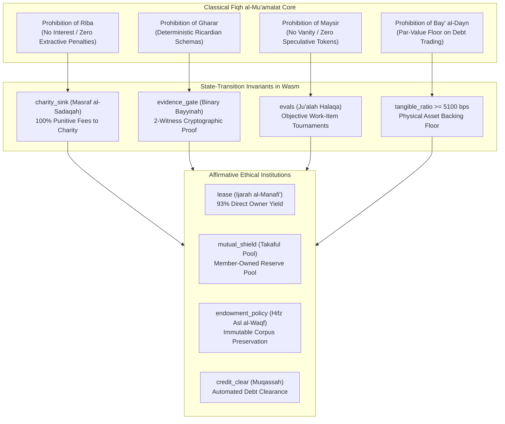

# Muabase: Ethical & Shariah Compliance Specification

> **Classical Jurisprudence Framework (*Fiqh al-Mu‘amalat*) & Mathematical Invariant Model**  
> *Authoritative Reference for Shariah Supervisory Boards (SSBs), Islamic Financial Institutions (IFIs), Ethical Cooperatives, and Legal Auditors.*

---

## 1. Executive Summary & Juridical Philosophy

Muabase is a serverless, real-time WebAssembly-in-database operating system engineered to execute commercial exchange under the strict mathematical constraints of classical Islamic commercial jurisprudence (**Fiqh al-Mu‘amalat**). 

Traditional financial infrastructure and smart contract platforms expose participants to systemic structural harms:
1. **Extractive Middlemen & Unearned Penalties (*Riba*):** Modern commerce platforms extract 20%–35% take-rates and enrich themselves on borrower distress, cancellation fees, and compounding late penalties.
2. **Contractual Ambiguity & Asymmetric Exploitation (*Gharar*):** Opaque terms of service, arbitrary platform fee adjustments, and algorithmic shadow-banning inject severe uncertainty into commercial relationships.
3. **Speculative Casino Dynamics (*Maysir* & *Qimar*):** Smart contract networks rely on volatile, speculative gas and governance tokens, turning productive enterprise into zero-sum financial speculation.
4. **Naked Debt Trading & Unbacked Leverage (*Bay‘ al-Dayn*):** Secondary financial markets trade disconnected debt claims at deep discounts, decoupling capital from tangible physical production.

Muabase eliminates these market failures by embedding classical jurisprudence constraints **directly into state transition validation logic** inside the WebAssembly storage engine (`Triedent`). By executing contracts on bare-metal database memory without intermediary servers or custodial keys, Muabase achieves mathematical compliance where violations of commercial ethics are not merely prohibited by policy—they are rejected by consensus as invalid state transitions.



---

## 2. Foundational Legal Maxims & Invariant Mapping

The protocol operationalizes classical legal maxims (*Al-Qawa‘id al-Fiqhiyyah*) established across the four Sunni madhahib (Hanafi, Maliki, Shafi‘i, Hanbali) and codified in the *Majallah al-Ahkam al-‘Adliyyah*:

### 2.1 The Principle of Risk-Reward Symmetry (*Al-Ghunm bi al-Ghurm*)
> *“Entitlement to revenue corresponds to exposure to liability.”* (Majallah, Art. 87; Hedaya)

In Muabase, capital providers cannot receive guaranteed returns without assuming asset liability. 
- In rental and lease contracts (`packages/user/LeaseEngine`), the asset owner (*Mu’jir*) bears structural risk and depreciation while the lessee (*Musta’jir*) pays strictly for temporary right-of-use (*Manfa‘ah*). 
- In fractional co-buying pools (`packages/user/Tokens`), rental yields and physical risks are distributed pro-rata according to digital equity ownership (*Musharakah*).

### 2.2 Benefit Accompanies Liability (*Al-Kharaj bi al-Daman*)
> *“Revenue is justified by risk-bearing.”* (Sunan Abu Dawud, Tirmidhi; Majallah, Art. 85)

Platforms and lenders are strictly barred from profiting from time-value extensions or debtor distress. Any punitive late fees or default deterrents are routed away from the creditor to an immutable community endowment charity sink (`charity_sink` / *Masraf al-Sadaqah*).

### 2.3 Prohibition of Deception & Uncertainty (*Nahy ‘an al-Gharar*)
> *“The Prophet (peace be upon him) prohibited sales involving Gharar (uncertainty/hazard).”* (Sahih Muslim)

All transaction logic executes deterministic WebAssembly code over unambiguous Ricardian contracts. Ambiguous variable pricing, opaque hidden fees, and hidden algorithmic manipulation are barred by state-machine verification.

### 2.4 Sanctity of Stipulations (*Al-Muslimun ‘ala Shurutihim*)
> *“Muslims are bound by their stipulations, except a stipulation that makes lawful what is unlawful or unlawful what is lawful.”* (Tirmidhi, Abu Dawud)

Smart contracts and programmatic agreements within `StagedTx` enforce Ricardian agreements with cryptographic guarantees, ensuring multi-party commitments execute exactly as agreed.

---

## 3. Comprehensive Dual-Locale Terminology Dictionary

Muabase provides a native terminology translation layer in `packages/user/Branding`. The table below establishes the canonical correspondence between neutral institutional identifiers, professional commercial primitives, and classical jurisprudence terms:

| Canonical Key (`key`) | Institutional Primitive (`"institutional"`) | Jurisprudential Locale (`"muamalat"`) | Transliteration & Linguistic Root | Classical Legal Basis & AAOIFI Standard Citation | Underlying Wasm Service |
| :--- | :--- | :--- | :--- | :--- | :--- |
| `asset_pool` | RWA Asset Series / Series LLC | **Sukuk al-Qirad / Musharakah** | *Ṣukūk al-Qirāḍ / Mushārakah* (شراكة / صكوك) | Fractional co-ownership of real physical assets (*A‘yān*) with shared equity, risk, and liability. **AAOIFI Standard No. 12 (Sharika) & No. 26 (Investment Sukuk).** | `"tokens"` |
| `lease` | Fixed Lease / P2P Rental | **Ijarah al-A‘yan wa al-Manafi‘** | *Ijārah al-A‘yān wa al-Manāfi‘* (إجارة المنافع) | Legal separation of permanent asset corpus (*‘Ayn*) from temporary right-of-use (*Manfa‘ah*). **AAOIFI Standard No. 9 (Ijarah).** | `"lease-eng"` |
| `equity_lease` | Progressive Lease-to-Own / Equity Lease | **Musharakah Mutanaqisah** | *Mushārakah Mutanāqiṣah* (مشاركة متناقصة) | Diminishing partnership where lessee gradually acquires fractional equity shares alongside declining rental payments. **AAOIFI Standard No. 12 (Musharakah).** | `"lease-eng"` |
| `mutual_shield` | Mutual Protection Reserve Pool | **Takaful (Tabarru‘ & Ta‘awun)** | *Takāful, Tabarru‘, Ta‘āwun* (تكافل / تبرع) | Member-owned solidarity reserve based on mutual guarantee and unilateral donation (*Tabarru‘*). Underwriting surplus (*Fā’iḍ*) returned pro-rata. **AAOIFI Standard No. 26 (Takaful).** | `"mutualshield"` / `"tokenstream"` |
| `claim_council` | Peer Triage Committee | **Majlis al-Tahkim & Shura** | *Majlis al-Taḥkīm* (مجلس التحكيم والشورى) | Impartial arbitration by qualified, reliable peers (*Ḥakam*) evaluating verifiable physical evidence (*Bayyinah*). **AAOIFI Standard No. 5 (Guarantees & Testimony).** | `"claimcouncil"` |
| `evals` | Objective Bounty & Claim Ranking | **Ju‘alah Halaqa** | *Ju‘ālah* (جعالة / حلقة) | Performance-based compensation for verified work items or deliverables, ranked via un-gameable Condorcet tournaments. **AAOIFI Standard No. 15 (Ju'alah).** | `"evals"` |
| `endowment_policy` | Trust Principal Preservation Lock | **Hifz Asl al-Waqf** | *Ḥifẓ Aṣl al-Waqf* (حفظ أصل الوقف) | Strict preservation of trust corpus (*Aṣl*); state transitions reject outward principal transfers, allowing only generated yield (*Manfa‘ah*) to flow. **AAOIFI Standard No. 33 (Waqf).** | `"auth-delegate"` / `"tokenstream"` |
| `priority_window` | Co-Owner Right of First Refusal | **Haqq al-Shuf‘ah** | *Ḥaqq al-Shuf‘ah* (حق الشفعة) | Mandatory exclusive pre-emption window for existing fractional co-owners (*Shurakā’*) before units can be offered to external parties. **Majallah al-Ahkam al-‘Adliyyah, Arts. 950–1044.** | `"tokens"` |
| `charity_sink` | Public Endowment Charity Sink | **Masraf al-Sadaqah** | *Maṣraf al-Ṣadaqah* (مصرف الصدقة) | Absolute non-profiteering rule: punitive late fees and deterrence surcharges are irrevocably routed to a public charity endowment. **AAOIFI Standard No. 3 (Default in Payment).** | `"lease-eng"` |
| `credit_clear` | Multilateral Invoice Netting | **Muqassah** | *Muqāṣṣah* (مقاصة) | Algorithmic set-off between reciprocal trading partners extinguishing obligations without physical money transfers. **AAOIFI Standard No. 4 (Settlement of Debt by Barter).** | `"creditclear"` |
| `liquidity_bridge` | Earned-Respect Liquidity Bridge | **Wajahah & Hawalah** | *Wajāhah wa Ḥawālah* (وجاهة وحوالة) | Debt novation and assignment backed by commercial goodwill, reputation (*Wajāhah*), and mutual trust without interest bearing. **AAOIFI Standard No. 7 (Hawalah).** | `"creditclear"` |
| `trust_score` | Reliability & Audit Score | **‘Adalah (Probity / Reliability)** | *‘Adālah* (عدالة) | Non-transferable, soulbound track record of uprightness, contract fulfillment, and truthful witness testimony. **Qur'an 2:282; AAOIFI Standard No. 5.** | `"credentials"` |
| `domain_badge` | Domain Competence Credential | **Ikhtisas (Domain Specialization)** | *Ikhtiṣāṣ* (اختصاص) | Soulbound domain capability verification (e.g. food inspector, master appraiser, mechanical certifier). **AAOIFI Standard No. 5.** | `"credentials"` |
| `tangible_ratio` | Tangible Asset Backing Ratio (>= 51%) | **Nisbat al-‘Ayn al-Haqiqiyyah** | *Nisbat al-‘Ayn* (نسبة العين الحقيقية) | Mathematical floor enforcing $\ge 51\%$ tangible asset/usufruct backing to bar naked debt trading (*Bay‘ al-Dayn*). **AAOIFI Standard No. 21 (Financial Paper) & No. 26 (Sukuk).** | `"tokens"` |
| `evidence_gate` | Dual-Witness Evidentiary Gate | **Bayyinah (Dual Proof / Attestation)** | *Bayyinah* (بينة عادلة) | Two-witness quorum verification of physical evidence digests (receipt hashes, condition photos) prior to escrow release. **Qur'an 2:282; AAOIFI Standard No. 5.** | `"staged-tx"` |
| `external_vault` | Non-Custodial Multi-Chain Splits | **Amanah Ghayr Hiyaziyyah** | *Amānah Ghayr Ḥiyāziyyah* (أمانة غير حيازية) | Fiduciary custody without possession; zero-key client-side multisig (Taproot Miniscript, EVM Safe) and direct payment splits eliminating custodial commingling. **Majallah, Arts. 762–832.** | `"ext-vault"` |
| `guild_pod` | Cooperative Pod & Review Circle | **Halaqat al-Tijarah / al-Shura** | *Ḥalaqāt al-Tijārah wa al-Shūrā* (حلقات الشورى) | Autonomous 5–7 peer governance pods operating consensus without centralized managerial capture. **Qur'an 42:38.** | `"guilds"` / `"subgroups"` |

---

## 4. Hardcoded Invariant Specifications & Fiqh Proofs

### 4.1 Invariant 1: Zero-*Riba* Restitution & Community Charity Sink (`charity_sink`)

#### The Classical Fiqh Problem
In traditional finance, lenders and rental platforms charge interest on overdue payments, compounding debt and profiting from the debtor’s financial distress (*Riba al-Jahiliyyah*). When a renter returns equipment late or a borrower delays repayment, charging an additional time-value fee is unanimously prohibited by classical consensus (*Ijma‘*). However, without a financial deterrent, delinquent actors may abuse the lessor's capital.

#### The Mathematical Solution in Muabase
In `packages/user/LeaseEngine` and `packages/user/TokenStream`, any penalty or cancellation surcharge $S_{\text{total}}$ is partitioned into two distinct components:
1. **Actual Direct Compensatory Damage ($L_{\text{direct}}$):** Directly provable costs incurred by the injured party (e.g., dry cleaning, repair fees, documented kitchen prep costs).
2. **Punitive Deterrence Surcharge ($P_{\text{punitive}}$):** An enforced penalty designed to deter willful negligence.

$$\text{Disbursement to Lessor / Injured Party} = \min(S_{\text{total}}, L_{\text{direct}})$$

$$\text{Disbursement to Charity Sink} = \max(0, S_{\text{total}} - L_{\text{direct}})$$

100% of $P_{\text{punitive}}$ is routed automatically by the state transition to the public endowment charity vault (`charity_sink_account`, default `"waqf-sadaqah"`). Under no circumstances can the lessor, lender, or node operator receive more than their exact compensatory restitution ($L_{\text{direct}}$).

#### Shariah Citation
> *“If a debtor defaults willfully, a penalty may be imposed upon him, provided that the penalty is spent on charitable purposes under the supervision of the Shariah Supervisory Board, and no part of it is taken by the creditor as income.”*  
> — **AAOIFI Shariah Standard No. 3 (Default in Payment by a Debtor), Clause 5/1**

---

### 4.2 Invariant 2: Binary *Bayyinah* Dual-Witness Evidentiary Gate (`evidence_gate`)

#### The Classical Fiqh Problem
Disputes in digital commerce are frequently compromised by fraudulent reviews, bot farms, and unilateral platform adjudication without verifiable witnesses. Islamic law explicitly requires verifiable testimony (*Shahadah*) and documentary proof (*Bayyinah*) provided by upright witnesses before rights are enforced or claims disbursed.

#### The Mathematical Solution in Muabase
In `packages/system/StagedTx` and `packages/user/ClaimCouncil`, escrow releases and damage claims cannot enter peer adjudication without satisfying a cryptographic 2-witness quorum:

$$\text{Quorum Valid} \iff \sum_{i=1}^{n} \mathbb{I}\left(\text{Sign}(W_i, H(M)) \land \text{trust\_score}(W_i) \ge \theta \land \text{domain\_badge}(W_i) \in \mathcal{D}\right) \ge 2$$

Where:
- $H(M)$ is the 32-byte SHA-256 digest of the physical evidence (e.g., photo of returned item, itemized POS receipt hash).
- $\text{trust\_score}(W_i) \ge \theta$ confirms the witness possesses verified probity (*‘Adalah* $\ge 70\%$).
- $\text{domain\_badge}(W_i) \in \mathcal{D}$ confirms competence in the relevant commercial domain (*Ikhtisas*).

#### Shariah Citation
> *“And bring to witness two witnesses from among your men. And if there are not two men, then a man and two women from those whom you accept of witnesses…”*  
> — **Qur'an 2:282 (Ayat al-Mudayanah)**

---

### 4.3 Invariant 3: Objective *Ju‘alah* Curation vs Elimination of Vanity Contests (`evals`)

#### The Classical Fiqh Problem
Web2 social networks rank individuals based on vanity metrics (followers, likes, popularity contests), fostering deceptive self-promotion and information cascades. Furthermore, pay-to-play review platforms extract bribes to elevate listings. Islamic jurisprudence prohibits vanity speculation and requires that compensation be tied to defined, verified work deliverables (*Ju‘alah*).

#### The Mathematical Solution in Muabase
Muabase completely deprecates all subjective ranking algorithms (`Fractals`, `FractalCore`, `FractalTester`). 
- **Humans are never ranked.** 
- Only verifiable work items, physical dishes, claims, and code deliverables (`BountyId`, `ClaimId`, `RestaurantRankBallot`) are evaluated.
- Ranking is computed via Wasm-native **Schulze Condorcet Tournaments** in `packages/user/Evaluations`. In a pairwise Condorcet tournament, candidate $A$ defeats candidate $B$ if and only if a verifiable majority of domain-qualified voters prefer $A$ over $B$ across all pairwise combinations, mathematically neutralizing vote-brigading and sybil attacks.

#### Shariah Citation
> *“Ju‘alah is a contract in which one party offers a specified compensation to whoever accomplishes a determined or undetermined service requiring an effort.”*  
> — **AAOIFI Shariah Standard No. 15 (Ju'alah), Clause 2**

---

### 4.4 Invariant 4: Tangible Asset Parity Floor & Prohibition of Debt Trading (`tangible_ratio`)

#### The Classical Fiqh Problem
The trading of debt contracts (*Bay‘ al-Dayn*) at a discount or premium is strictly prohibited because trading monetary obligations against money of a different amount constitutes *Riba al-Fadl*. Under AAOIFI standards, a bundle of assets containing both debt receivables and tangible physical assets can only be traded at non-par if tangible assets constitute a predominant share.

#### The Mathematical Solution in Muabase
In `packages/user/Tokens` and `packages/user/TokenSwap`, RWA tokens are annotated with a verifiable tangible backing ratio:

$$\text{tangible\_ratio\_bps} = \frac{\text{Value of Physical Real Assets } (A‘yān) + \text{Usufruct } (Manāfi‘)}{\text{Total Portfolio Valuation}} \times 10,000$$

The consensus engine enforces the strict invariant:

$$\text{tangible\_ratio\_bps} \ge 5100 \quad (51.00\%)$$

If an asset pool's physical backing drops below 51% (e.g., due to asset liquidation or excess cash receivables), secondary market trading at a discount or premium is **automatically halted by the state machine**. The asset may only be liquidated or transferred at exact nominal par value ($P = 1.0$), eliminating speculative debt discounting.

#### Shariah Citation
> *“If the assets of a Sukuk pool represent a mixture of tangible assets, usufructs, services, and debts/cash, it is permissible to trade the Sukuk at market value provided that the tangible assets and usufructs constitute the majority of the pool (at least 51%). If they do not, the rules of debt exchange (Sarf and Bay' al-Dayn) apply.”*  
> — **AAOIFI Shariah Standard No. 26 (Investment Sukuk), Clause 5/1/8/5**

---

### 4.5 Invariant 5: Right of First Refusal (*Haqq al-Shuf‘ah* / `priority_window`)

#### The Classical Fiqh Problem
When an owner of a fractional property or business asset sells their share to an unknown third party, existing co-owners face operational friction, unwanted partners, and potential loss of harmony. Classical Islamic law gives existing co-owners the legal right of pre-emption (*Shuf‘ah*) to acquire the outgoing partner's share at fair market value before outside buyers.

#### The Mathematical Solution in Muabase
When a co-owner lists their digital shares (`Tokens`) for sale:
1. An on-chain pre-emption lock (`priority_window_sec`, default $86,400\text{ seconds} = 24\text{ hours}$) is automatically activated.
2. During this window, only existing shareholders of that specific `tokenId` series can purchase the offered units.
3. External accounts attempting to execute `purchaseDigitalShares` are rejected with `Shuf'ah Pre-emption Lock Active`.

#### Shariah Citation
> *“The Prophet (peace be upon him) decreed the right of pre-emption (Shuf‘ah) in every undivided joint property. But when the boundaries are fixed and the roads are laid out, there is no pre-emption.”*  
> — **Sahih al-Bukhari, Hadith 2257; Majallah, Art. 950**

---

### 4.6 Invariant 6: Trust Corpus Preservation Lock (*Hifz Asl al-Waqf* / `endowment_policy`)

#### The Classical Fiqh Problem
Endowments (*Awqaf*) are established to create perpetual public benefit. A central tenet of Waqf jurisprudence is that the principal corpus (*Asl*) can never be sold, pledged, gifted, or consumed; only the generated productive fruit or rental yield (*Manfa‘ah* / *Thamarah*) may be distributed to beneficiaries.

#### The Mathematical Solution in Muabase
In `packages/system/AuthDelegate` and `packages/user/TokenStream`:
- Accounts designated as Waqf principal are governed by `endowment_policy`.
- Outward asset transfer actions attempting to debit the principal balance for consumption are rejected at state transition.
- Capital can only be allocated into approved productive asset series (`asset_pool`).
- Generated rental income and lease distributions bypass the principal lock and flow directly to the designated beneficiary account (*Manfa‘ah*).

#### Shariah Citation
> *“Give the property as an endowment: its corpus may not be sold, gifted, or inherited, and its fruits shall be spent for charitable purposes.”*  
> — **Hadith of Umar ibn al-Khattab on the Waqf of Khaybar (Sahih al-Bukhari, Hadith 2772; AAOIFI Standard No. 33)**

---

### 4.7 Invariant 7: Multilateral Debt Clearance & Liquidity Routing (`credit_clear` & `liquidity_bridge`)

#### The Classical Fiqh Problem
Commercial supply chains suffer from liquidity crunches when businesses wait 60–90 days for invoice payment. Predatory factoring companies exploit this by buying invoices at steep discounts (charging 2%–5% per invoice), which constitutes prohibited debt discounting (*Bay‘ al-Dayn*).

#### The Mathematical Solution in Muabase
In `packages/user/CreditClear`:
1. **Automated Algorithmic Netting (*Muqassah*):** Bilateral and cyclic multi-party B2B debts are continuously detected and cancelled without cash transfers. If Company A owes B \$10,000, B owes C \$10,000, and C owes A \$10,000, the system extinguishes all three obligations at zero cost ($0\%$ interest, $0\%$ factoring fee).
2. **Reputation-Backed Novation (*Wajahah & Hawalah*):** Trade credit is assigned across verified commercial trust graphs without compounding interest, backed by mutual reputation and collateral.

#### Shariah Citation
> *“Muqassah (set-off) is the clearing of reciprocal debts between two parties, and it is legally permissible and encouraged to extinguish obligations without cash transfer.”*  
> — **AAOIFI Shariah Standard No. 4 (Settlement of Debt by Barter), Clause 2**

---

### 4.8 Invariant 8: Non-Custodial Trustee Escrow (*Amanah Ghayr Hiyaziyyah* / `external_vault`)

#### The Classical Fiqh Problem
Under classical law, a deposit or escrow held by a fiduciary is a trust (*Amanah*). If a custodian commingles user funds with their own operating treasury or re-hypothecates them for yield, their status changes from a trustworthy trustee (*Amin*) to a liable trespasser (*Damin*). Modern centralized exchanges and fintech platforms routinely misappropriate client deposits.

#### The Mathematical Solution in Muabase
In `packages/user/ExternalVault`:
- Muabase node operators and core contributors hold **zero private keys** and zero physical custody over user funds.
- Capital settlement executes directly via client-side multisig (Bitcoin Taproot Miniscript PSBTs, EVM Safe, Solana Squads) or automated Stripe Connect multi-party destination splits.
- Software protocols act purely as programmatic fiduciaries (*Wadi‘ah Yad Amanah*), completely eliminating the risk of custodial commingling.

#### Shariah Citation
> *“An item held in trust (Amanah) is not subject to liability if lost or destroyed without negligence or transgression by the trustee.”*  
> — **Majallah al-Ahkam al-‘Adliyyah, Art. 768**

---

## 5. Developer Integration & Dual-Locale SDK Usage

Developers can toggle the SDK between neutral institutional terminology and classical jurisprudence terms with a single configuration flag:

```typescript
import { createMuabaseClient } from "@muabase/headless-sdk";

// Initialize client with Jurisprudential (Muamalat) locale
const client = createMuabaseClient({
  endpoint: "https://node.muabase.org",
  locale: "muamalat", // Exposes classical Fiqh terms in UI helpers
});

// Dynamic term resolution
const leaseTerm = await client.branding.translateTerm("lease");
console.log(leaseTerm); 
// Output: "Ijarah al-A‘yan wa al-Manafi‘"

const poolTerm = await client.branding.translateTerm("asset_pool");
console.log(poolTerm); 
// Output: "Sukuk al-Qirad / Musharakah"
```

### Creating a Shariah-Compliant Usufruct Lease
```typescript
// Execute fixed-term usufruct lease with autonomous fee distribution
const lease = await client.leaseEngine.createLease({
  lessor: "asset-owner",
  tokenId: 1042,
  durationSec: 3 * 86400, // 3 days
  grossPayment: { value: 1500000 }, // $150.00
  paymentTokenId: 1,
  preConditionEvidenceHash: "0x4e2d...proof_hash", // Cryptographic Bayyinah
  charitySinkAccount: "waqf-sadaqah", // Zero-Riba Charity Sink
});

// Distribution executed by Wasm state machine:
// - 9300 bps (93%) -> Asset Owner (Ujrah / Rental yield)
// - 400 bps  (4%)  -> Mutual Protection Pool (Tabarru' to Takaful)
// - 300 bps  (3%)  -> Node Infrastructure Operator (SaaS fee)
```

---

## 6. Regulatory Harmony: Global Fintech & Shariah Governance

Muabase satisfies both US regulatory standards and international Islamic finance standards:

1. **NYDFS BitLicense Safe Harbor (`23 NYCRR § 200.2(q)`):** Because the protocol operates in a 100% non-custodial manner with zero operator keys and no volatile governance token, infrastructure operators qualify under pure software developer exemptions.
2. **AAOIFI Shariah Governance Standards (GSIFI):** The state machine's deterministic invariant checks provide an automated, continuous audit trail for internal Shariah review units and external Shariah Supervisory Boards (SSBs).
3. **Absence of Speculative Gas Arbitrage:** Bandwidth and computation are bounded by CPU time budgets and bonded capacity, eliminating Front-Running, Maximal Extractable Value (MEV), and speculative gas price manipulation.

---

## 7. Shariah Compliance Verification Checklist for Auditors

When conducting an institutional Shariah audit of a Muabase deployment, verify the following configuration parameters:

| Verification Item | Required Parameter / Invariant | Validation Method |
| :--- | :--- | :--- |
| **Charity Sink Route** | `charity_sink_account != lessor_account` | Verify `packages/user/LeaseEngine` dispatches punitive late fees to non-profit public vault. |
| **Tangible Backing Floor** | `tangible_ratio_bps >= 5100` | Query `packages/user/Tokens` table for pool asset backing ratio. |
| **Witness Verification Gate** | `witness_quorum >= 2` | Verify `packages/system/StagedTx` requires two independent signed attestations before claim triage. |
| **Pre-emption Window** | `priority_window_sec >= 86400` | Ensure co-owners receive minimum 24-hour exclusive purchase window. |
| **Non-Custodial Escrow** | `operator_keys == 0` | Inspect `packages/user/ExternalVault` to confirm zero platform custody of user funds. |
| **Waqf Corpus Lock** | `endowment_policy == active` | Confirm outward principal debits from trust accounts fail with state transition error. |

For inquiries, formal fatwas, or institutional audit certifications, refer to the documentation repository or contact the Muabase governance council.
