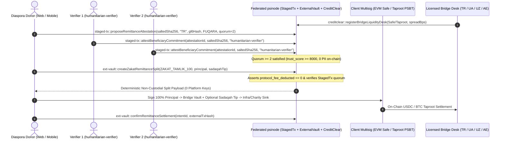

# Humanitarian & Zakat Remittance Corridors Quickstart (QırımBridge / Ummah Rails)

> **Reference Architecture for Non-Custodial Diaspora Relief & Zero-Fee Zakat *Tamlik* Corridors**  
> *Target Runtime: `psinode` (`Triedent` Wasm-in-Database) + `@muabase/headless-sdk`*  
> *Regulatory & Jurisprudential Profile: NYDFS BitLicense `23 NYCRR § 200.2(q)` Non-Custodial Safe Harbor &bull; OFAC General License No. 6 Personal Remittance Framing &bull; AAOIFI Shariah Standard No. 35 (Zakat Tamlik)*

---

## 1. Architectural Overview & Threat Model

Displaced and sanctioned-adjacent diaspora communities—such as the **Crimean Tatar relief network (QırımBridge)** operating across mainland Ukraine (`"UA"`), Turkey (`"TR"`), Uzbekistan (`"UZ"`), the UAE (`"AE"`), and Western donor hubs—face three compounding failures on legacy financial and crowdfunding rails:

1. **Fee Erosion Violating Zakat *Tamlik*:** Classical Islamic jurisprudence (*Fiqh al-Mu‘amalat*, Qur'an 9:60, AAOIFI Standard No. 35) mandates **Tamlik**—100% direct transfer of Zakat corpus ownership to eligible individual recipients (*Asnaf*). Platforms that skim 3%–10% administrative fees or FX spreads from Zakat principal invalidate full discharge of the donor's obligation.
2. **Custodial De-Risking & Key Seizure:** Centralized NGO portals and custodial crypto wallets hold pooled user funds, triggering money-transmitter licensing burdens, account freezes, and single-point-of-compromise risk.
3. **Plaintext PII Exposure (*Darar*):** Storing recipient names, national IDs, phone numbers, or off-ramp IBANs on public blockchains or centralized SaaS databases endangers vulnerable families in high-friction regions.

Muabase resolves all three constraints at the **WebAssembly state-transition layer**:



---

## 2. Step 1: Spin Up a Federated Self-Hosted `psinode`

Diaspora relief chapters (e.g., Istanbul, Kyiv, Tashkent, New York) can run a sovereign, federated `psinode` cluster with **zero intermediate backend servers** and **zero custodial keys**:

```bash
# 1. Start a local or federated community psinode instance
psinode --database /var/lib/muabase/qirimbridge-db \
        --producer qirim-ist-1 \
        --listen 0.0.0.0:8080 \
        --host qirim.node.muabase.org

# 2. Boot core system & Muabase commerce packages
psibase boot --host http://localhost:8080 \
  Accounts AuthSig Credentials StagedTx Events \
  Branding Tokens ExternalVault CreditClear

# 3. Configure Muamalat jurisprudential terminology locale on-chain
psibase push --host http://localhost:8080 \
  --sender branding \
  branding setTerminologyLocale '{"locale":"muamalat"}'
```

With `locale: "muamalat"` active, `packages/user/Branding` automatically resolves:
- `zakat_tamlik` $\rightarrow$ **`Zakat Tamlik Vault (Tamlik al-Asnaf 100%)`**
- `asnaf_gate` $\rightarrow$ **`Asnaf Verification Gate (Bayyinat Istihqaq al-Zakat)`**
- `bridge_liquidity_desk` $\rightarrow$ **`Bridge Liquidity Desk (Maktab al-Sarf wa al-Hawalah)`**

---

## 3. Step 2: Issue Soulbound `humanitarian-verifier` Credentials

Beneficiary eligibility (*Asnaf* status and non-SDN personal remittance screening) is attested by independent community elders, field coordinators, or legal aid officers. Credentials in `packages/system/Credentials` are **soulbound** (non-transferable) and require both:
- Active `domain_badge` = `"humanitarian-verifier"`
- `trust_score >= 8000` ($80.00\%$ probity / *‘Adalah*) and `precision_score >= 8000` ($80.00\%$ *Dabt*)

```bash
# Create accounts for two independent community verifiers
psibase create-account -a http://localhost:8080 qirim-verif1 --key <PUBKEY_1>
psibase create-account -a http://localhost:8080 qirim-verif2 --key <PUBKEY_2>

# Council / accreditor issues soulbound "humanitarian-verifier" domain badges
psibase push -a http://localhost:8080 --sender majlis-admin credential issueDomainBadge '{
  "account": "qirim-verif1",
  "domain": "humanitarian-verifier",
  "cert_hash": "0x5f2b91e74a1c8b30e4d679112233445566778899aabbccddeeff001122334455"
}'

psibase push -a http://localhost:8080 --sender majlis-admin credential issueDomainBadge '{
  "account": "qirim-verif2",
  "domain": "humanitarian-verifier",
  "cert_hash": "0x7c8d12f09b2e4a51f8c3902233445566778899aabbccddeeff00112233445566"
}'

# Initialize probity (trust_score >= 8000) and domain accuracy (precision_score >= 8000)
psibase push -a http://localhost:8080 --sender majlis-admin credential updateTrustScore '{
  "account": "qirim-verif1", "score": 9200, "is_success": true
}'
psibase push -a http://localhost:8080 --sender majlis-admin credential updatePrecisionScore '{
  "account": "qirim-verif1", "domain": "humanitarian-verifier", "score": 9000, "is_accurate": true
}'

psibase push -a http://localhost:8080 --sender majlis-admin credential updateTrustScore '{
  "account": "qirim-verif2", "score": 8800, "is_success": true
}'
psibase push -a http://localhost:8080 --sender majlis-admin credential updatePrecisionScore '{
  "account": "qirim-verif2", "domain": "humanitarian-verifier", "score": 8600, "is_accurate": true
}'
```

---

## 4. Step 3: Create Zero-PII Beneficiary Commitments Off-Chain

**Never submit names, passport numbers, street addresses, or bank IBANs to `psinode`.**  
Instead, encrypt the off-chain payout packet directly between the field coordinator and the licensed bridge-country exchange desk (e.g. via X25519 / Age encryption), prepend a CSPRNG 32-byte salt, and commit only the 32-byte SHA-256 digest on-chain:

```typescript
import { assertValidSha256Commitment } from "@muabase/headless-sdk";

async function createSaltedBeneficiaryCommitment(encryptedPayoutCiphertext: Uint8Array): Promise<{
  saltHex: string;
  recipientCommitmentHash: string;
}> {
  const salt = crypto.getRandomValues(new Uint8Array(32));
  const preimage = new Uint8Array(salt.length + encryptedPayoutCiphertext.length);
  preimage.set(salt, 0);
  preimage.set(encryptedPayoutCiphertext, salt.length);

  const digestBuffer = await crypto.subtle.digest("SHA-256", preimage);
  const hex = Array.from(new Uint8Array(digestBuffer))
    .map((b) => b.toString(16).padStart(2, "0"))
    .join("");
  const saltHex = Array.from(salt)
    .map((b) => b.toString(16).padStart(2, "0"))
    .join("");

  return {
    saltHex: `0x${saltHex}`, // Retained off-chain with encrypted packet for bridge desk verification
    recipientCommitmentHash: assertValidSha256Commitment(`0x${hex}`),
  };
}
```

Similarly, hash the canonical Ricardian personal remittance declaration confirming non-commercial family/humanitarian P2P support to a verified non-SDN individual (`nonCommercialPersonalDeclarationHash`).

---

## 5. Step 4: End-to-End 100% *Tamlik* Zakat Split & Reactive Tracking

### 5.1 Bridge Liquidity Desk Registration (`creditclear`)
Licensed exchange desks in bridge jurisdictions (`"TR"`, `"AE"`, `"UA"`, `"UZ"`) publish their client-verifiable Safe / Taproot / Squads multisig vaults and live FX spreads without Muabase holding custody:

```typescript
import { createMuabaseClient } from "@muabase/headless-sdk";

const deskClient = createMuabaseClient({
  endpoint: "https://qirim.node.muabase.org",
  locale: "muamalat",
  account: "bosphorus-desk",
});

await deskClient.creditClear.registerBridgeLiquidityDesk({
  corridorJurisdiction: "TR",
  deskLabel: "Bosphorus Licensed Sarf & Relief Desk (Istanbul)",
  licenseRegistryHash: "0x4b227777d4dd1fc61c6f884f48641d02b4d121d3fd328cb08b5531fcacdabf8a",
  evmSafeAddress: "0x90F8bf6A479f320ead074411a4B0e7944Ea8c9C1",
  btcTaprootDescriptor:
    "tr(xpub661MyMwAqRbcFtXgS5sYJABqqG9YLmC4Q1Rdap9gSE8NqtwybGhePY2gZ29ESFjqJoCu1Rupje8YtGqsefD265TMg7usUDFdp6W1EGMcet8)",
  fxSpreadBps: 75, // 0.75% transparent FX spread (funded via donor sadaqahTipAmount, never Zakat principal)
  maxPerTxUsdcCents: 2_500_000, // $25,000.00 max per P2P remittance
  sadaqahFeeSubsidySupported: true,
});
```

### 5.2 Dual-Witness Attestation & 100% *Tamlik* Settlement (`staged-tx` + `ext-vault`)

```typescript
const donorClient = createMuabaseClient({
  endpoint: "https://qirim.node.muabase.org",
  locale: "muamalat",
  account: "donor-ny",
});

// 1. Discover active bridge corridors in Turkey ("TR")
const corridors = await donorClient.creditClear.listBridgeCorridors({
  corridorJurisdiction: "TR",
  activeOnly: true,
});
const selectedDesk = corridors[0];

// 2. Propose zero-PII PersonalRemittanceAttestation (requires witness_quorum >= 2)
const { attestationId } = await donorClient.stagedTx.proposeRemittanceAttestation({
  recipientCommitmentHash,
  corridorJurisdiction: "TR",
  nonCommercialPersonalDeclarationHash,
  asnafCategory: "FUQARA", // Eligible Zakat category (FUQARA | MASAKIN | GHARIMIN | IBN_AL_SABIL | GENERAL_SADAQAH)
  witnessQuorum: 2,
});

// 3. Verifiers 1 & 2 independently verify off-chain packet & co-sign on-chain
await verifier1Client.stagedTx.attestBeneficiaryCommitment({
  attestationId,
  recipientCommitmentHash,
  domainBadge: "humanitarian-verifier",
});

await verifier2Client.stagedTx.attestBeneficiaryCommitment({
  attestationId,
  recipientCommitmentHash,
  domainBadge: "humanitarian-verifier",
});

// 4. Create 100% Tamlik Zakat split intent
//    - 100% of $1,000.00 (100_000 cents) Zakat principal routes to recipientBridgeVault
//    - Optional $15.00 (1_500 cents) Sadaqah tip routes separately to cover 0.75% FX spread + node ops
//    - Passing protocolFeeDeduction > 0 in ZAKAT_TAMLIK_100 immediately panics in both SDK and Wasm!
const splitIntent = await donorClient.externalVault.createZakatRemittanceSplit({
  attestationId,
  mode: "ZAKAT_TAMLIK_100",
  railType: "evm_safe", // or "bitcoin_taproot" | "solana_squads" | "bridge_corridor_api"
  corridorJurisdiction: "TR",
  recipientBridgeVault: selectedDesk.evmSafeAddress,
  infraOpsVault: "0xQirimSadaqahInfraSink0000000000000000002",
  zakatPrincipalAmount: 100_000,
  sadaqahTipAmount: 1_500,
  protocolFeeDeduction: 0,
  recipientCommitmentHash,
});

// 5. Donor signs splitIntent.payloadJson client-side via Safe / hardware wallet, then records tx hash
await donorClient.externalVault.confirmRemittanceSettlement({
  intentId: splitIntent.intentId,
  externalTxRef: "0x8a4f2c9b11e0d34789ab12cd34ef567890ab12cd34ef567890ab12cd34ef5678",
});
```

### 5.3 Reactive SSE Quorum & Settlement Subscription (`useMuabaseTable`)

```tsx
import { useMuabaseTable } from "@muabase/headless-sdk";
import type { PersonalRemittanceAttestation, ZakatRemittanceIntent } from "@muabase/headless-sdk";

export function CorridorStatusMonitor({ client }: { client: any }) {
  const attestations = useMuabaseTable<PersonalRemittanceAttestation>({
    client,
    service: "staged-tx",
    table: "remittanceAttestationTable",
    transport: "sse",
    query: `{
      remittanceAttestationTable(corridorJurisdiction: "TR") {
        attestationId
        corridorJurisdiction
        asnafCategory
        witnessQuorum
        verifiedWitnesses
        quorumSatisfied
      }
    }`,
  });

  const settlements = useMuabaseTable<ZakatRemittanceIntent>({
    client,
    service: "ext-vault",
    table: "remittanceIntentTable",
    transport: "sse",
    query: `{
      remittanceIntentTable(corridorJurisdiction: "TR") {
        intentId
        attestationId
        mode
        zakatPrincipalAmount
        recipientAmount
        sadaqahTipAmount
        protocolFeeDeducted
        externalTxRef
        settled
      }
    }`,
  });

  return (
    <div>
      <h3>Asnaf Verification Quorum ({attestations.data.length})</h3>
      <h3>Settled Tamlik Remittances ({settlements.data.filter((i) => i.settled).length})</h3>
    </div>
  );
}
```

---

## 6. Regulatory & Shariah Compliance Checklist

| Dimension | Standard / Citation | Enforced Protocol Mechanism |
| :--- | :--- | :--- |
| **Non-Custodial Software Safe Harbor** | **NYDFS BitLicense `23 NYCRR § 200.2(q)`** | `psinode` operators and UI hosts hold **0 private keys** and never take possession of fiat or digital assets. `ExternalVault` emits deterministic client-signed EVM Safe, Bitcoin Taproot Miniscript, or Solana Squads payloads. |
| **Personal Remittance Compliance** | **OFAC General License No. 6 / Non-Commercial P2P** | Every `PersonalRemittanceAttestation` requires a non-zero 32-byte `non_commercial_personal_declaration_hash` Ricardian digest attesting personal, non-commercial humanitarian remittance to verified non-SDN individuals via licensed bridge corridors (`"TR"`, `"AE"`, `"UA"`, `"UZ"`). |
| **100% Zakat *Tamlik* Delivery** | **Qur'an 9:60; AAOIFI Shariah Standard No. 35** | `CorridorSplitMode::ZAKAT_TAMLIK_100` asserts `protocol_fee_deduction == 0` and routes 100% of `zakat_principal_amount` to `recipient_bridge_vault`. Any fee deduction panics at state transition. |
| **Voluntary Fee & FX Separation** | **AAOIFI Standard No. 35 (*Tabarru‘ / Sadaqah Nafilah*)** | Gas, node hosting, and bridge FX spreads (`fx_spread_bps`) are funded exclusively via an optional, separate donor `sadaqah_tip_amount` split routed to `infra_ops_vault` / `charity_sink`. |
| **Zero-PII Beneficiary Protection (*Satr*)** | **Qur'an 2:282; *La Darar wa la Dirar*** | Plaintext names, addresses, and IBANs are rejected by 32-byte SHA-256 hex digest and 2-letter ISO corridor guards. Settlement is blocked until `witness_quorum >= 2` `"humanitarian-verifier"` badge holders (`trust_score >= 8000`) co-sign. |
