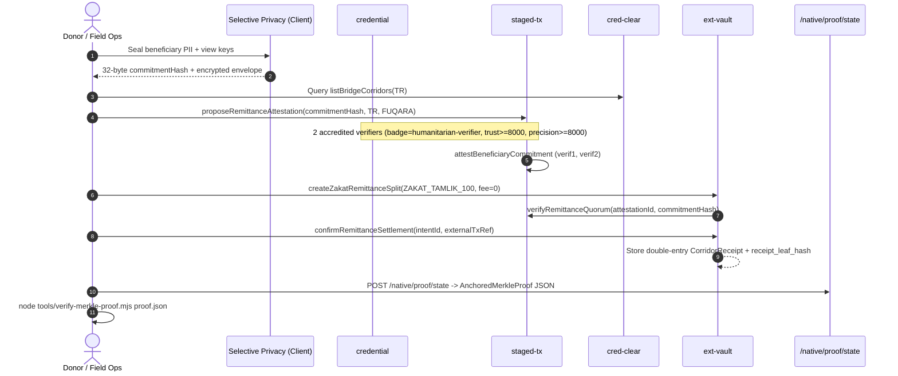

# Humanitarian & Zakat Corridor Quickstart (App 1)

**Operator & Developer Runbook — 15-Minute Local Setup**  
**Canonical Wasm Services:** `credential`, `staged-tx`, `cred-clear`, `ext-vault`, `producers`  
**Regulatory & Fiqh Alignment:** `compliance.md` Invariant 9 (*Tamlik* 100%, Zero-PII *Satr*, Dual-Witness *Bayyinah*), NYDFS `23 NYCRR § 200.2(q)` (Non-Custodial), OFAC GL 6 Personal Remittance.

---

## 1. Architecture & Data Flow

Plaintext beneficiary PII **never** enters `psinode`. The donor or field coordinator seals PII off-chain inside a selective-disclosure envelope (`packages/shared-ui/headless-sdk/src/privacy.ts` or `rust/muabase_institutional`), commits only the 32-byte salted SHA-256 hash on-chain, gathers `>= 2` accredited verifier signatures, executes a zero-fee `ZAKAT_TAMLIK_100` settlement split, and exports an offline-verifiable `dwal_merkle` inclusion proof + `compliance.md` evidence pack.



---

## 2. Step 1 — Start a Local `psinode` and Boot Services

> **CLI Note:** `psinode` takes the database directory as its **first positional argument** (no `--database` flag). `psibase` uses `-a` for the API URL, `boot -p <producer>`, `create <acct> -k <pubkey>`, and `push <actions.json>`.

```bash
# 1. Start local node (positional DB path, producer `qirim`, HTTP on 127.0.0.1:8080)
psinode ./qirim-db -p qirim -l 127.0.0.1:8080 --host muabase.local

# 2. Boot core + corridor packages (in a second terminal)
psibase -a http://127.0.0.1:8080 boot -p qirim \
  Accounts AuthSig AuthDelegate Credentials StagedTx Events Branding Tokens ExternalVault CreditClear Producers
```

Verify node readiness:

```bash
curl -s http://127.0.0.1:8080/native/admin/status
```

---

## 3. Step 2 — Accredit an Institutional Issuer & Issue Verifier Credentials

`Credentials` enforces issuer governance via `AuthorizedIssuerTable`. Accredit `majlis` first, create two independent verifiers (`verif1`, `verif2`), and grant each an active `"humanitarian-verifier"` badge with `trust_score >= 8000` and `precision_score >= 8000`:

```bash
# Create accounts (valid Psibase AccountNumbers)
psibase -a http://127.0.0.1:8080 create majlis  -k <MAJLIS_PUBKEY>
psibase -a http://127.0.0.1:8080 create verif1  -k <VERIF1_PUBKEY>
psibase -a http://127.0.0.1:8080 create verif2  -k <VERIF2_PUBKEY>
psibase -a http://127.0.0.1:8080 create donor   -k <DONOR_PUBKEY>
psibase -a http://127.0.0.1:8080 create desktr  -k <DESK_PUBKEY>
```

Push the accreditation and credential actions as a JSON action array (`corridor-setup.json`):

```json
[
  {
    "sender": "producers+3",
    "service": "credential",
    "method": "authorizeIssuer",
    "data": { "issuer": "majlis", "domain": "humanitarian-verifier" }
  },
  {
    "sender": "majlis",
    "service": "credential",
    "method": "issueDomainBadge",
    "data": {
      "account": "verif1",
      "domain": "humanitarian-verifier",
      "cert_hash": "5f2b000000000000000000000000000000000000000000000000000000000001"
    }
  },
  {
    "sender": "majlis",
    "service": "credential",
    "method": "updateTrustScore",
    "data": { "account": "verif1", "score": 9200, "is_success": true }
  },
  {
    "sender": "majlis",
    "service": "credential",
    "method": "updatePrecisionScore",
    "data": { "account": "verif1", "domain": "humanitarian-verifier", "score": 9000, "is_accurate": true }
  },
  {
    "sender": "majlis",
    "service": "credential",
    "method": "issueDomainBadge",
    "data": {
      "account": "verif2",
      "domain": "humanitarian-verifier",
      "cert_hash": "7c8d000000000000000000000000000000000000000000000000000000000002"
    }
  },
  {
    "sender": "majlis",
    "service": "credential",
    "method": "updateTrustScore",
    "data": { "account": "verif2", "score": 8800, "is_success": true }
  },
  {
    "sender": "majlis",
    "service": "credential",
    "method": "updatePrecisionScore",
    "data": { "account": "verif2", "domain": "humanitarian-verifier", "score": 8600, "is_accurate": true }
  }
]
```

```bash
psibase -a http://127.0.0.1:8080 push corridor-setup.json -s <SIGNING_KEY>
```

---

## 4. Step 3 — Protect Beneficiary PII via Selective Disclosure

Seal beneficiary PII off-chain with `@muabase/headless-sdk` (`packages/shared-ui/headless-sdk/src/privacy.ts`). Only `envelope.commitmentHex` (a 32-byte salted SHA-256 digest) is written on-chain; auditors or field partners with a `ViewKeyGrant` open the encrypted envelope locally:

```ts
import {
  sealSelectiveDisclosureEnvelope,
  openSelectiveDisclosureEnvelope,
  assertValidSha256Commitment,
} from "@muabase/headless-sdk";

const auditorViewSecret = crypto.getRandomValues(new Uint8Array(32));
const beneficiaryPii = JSON.stringify({
  legalName: "Amina Q.",
  corridor: "TR",
  payoutChannel: "IBAN:TR001234567890",
  asnafCategory: "FUQARA",
});

// 1. Encrypt PII off-chain under AES-256-GCM bound to the salted SHA-256 commitment
const envelope = await sealSelectiveDisclosureEnvelope(beneficiaryPii, [
  { viewerId: "auditor-1", secret: auditorViewSecret },
]);

// 2. Validate zero-PII commitment before submitting on-chain
const commitmentHash = assertValidSha256Commitment(envelope.commitmentHex);

// 3. Selective disclosure: only holders of an authorized view key can open & verify preimage
const disclosed = await openSelectiveDisclosureEnvelope(envelope, "auditor-1", auditorViewSecret);
```

---

## 5. Step 4 — Execute End-to-End 100% *Tamlik* Zakat Disbursement

1. **Register a non-custodial bridge desk (`cred-clear`):**
   ```json
   [
     {
       "sender": "desktr",
       "service": "cred-clear",
       "method": "registerBridgeLiquidityDesk",
       "data": {
         "corridor_jurisdiction": "TR",
         "desk_label": "Bosphorus Non-Custodial Sarf",
         "license_registry_hash": "4b227777d4dd1fc61c6f884f48641d02b4d121d3fd328cb08b5531fcacdabf8a0",
         "evm_safe_address": "0x90F8bf6A479f320ead074411a4B0e7944Ea8c9C1",
         "btc_taproot_descriptor": "",
         "solana_squads_pda": "",
         "fx_spread_bps": 75,
         "max_per_tx_usdc_cents": 2500000,
         "sadaqah_fee_subsidy_supported": true
       }
     }
   ]
   ```

2. **Propose attestation & collect 2-of-2 witness co-signatures (`staged-tx`):**
   ```json
   [
     {
       "sender": "donor",
       "service": "staged-tx",
       "method": "proposeRemittanceAttestation",
       "data": {
         "recipient_commitment_hash": "<COMMITMENT_HEX_64>",
         "corridor_jurisdiction": "TR",
         "non_commercial_personal_declaration_hash": "e3b0c44298fc1c149afbf4c8996fb92427ae41e4649b934ca495991b7852b855",
         "asnaf_category": "FUQARA",
         "witness_quorum": 2
       }
     },
     {
       "sender": "verif1",
       "service": "staged-tx",
       "method": "attestBeneficiaryCommitment",
       "data": {
         "attestation_id": 1,
         "recipient_commitment_hash": "<COMMITMENT_HEX_64>",
         "domain_badge": "humanitarian-verifier"
       }
     },
     {
       "sender": "verif2",
       "service": "staged-tx",
       "method": "attestBeneficiaryCommitment",
       "data": {
         "attestation_id": 1,
         "recipient_commitment_hash": "<COMMITMENT_HEX_64>",
         "domain_badge": "humanitarian-verifier"
       }
     }
   ]
   ```

3. **Create 100% *Tamlik* split intent & confirm settlement (`ext-vault`):**
   - `protocol_fee_deduction` **must be `0`** under `ZAKAT_TAMLIK_100` (any non-zero fee panics with `Tamlik Violation`).
   - `confirmRemittanceSettlement` enforces caller authorization (`donor` or `ext-vault`), rejects double-settlement, stores a double-entry `CorridorReceipt` (`CorridorReceiptTable`), and emits `complianceReceipt(intent_id, receipt_leaf_hash)`.

   ```json
   [
     {
       "sender": "donor",
       "service": "ext-vault",
       "method": "createZakatRemittanceSplit",
       "data": {
         "attestation_id": 1,
         "mode": "ZAKAT_TAMLIK_100",
         "rail_type": "evm_safe",
         "corridor_jurisdiction": "TR",
         "recipient_bridge_vault": "0x90F8bf6A479f320ead074411a4B0e7944Ea8c9C1",
         "infra_ops_vault": "0xQirimSadaqahOpsVault00000000000000000002",
         "zakat_principal_amount": 100000,
         "sadaqah_tip_amount": 1500,
         "protocol_fee_deduction": 0,
         "recipient_commitment_hash": "<COMMITMENT_HEX_64>"
       }
     },
     {
       "sender": "donor",
       "service": "ext-vault",
       "method": "confirmRemittanceSettlement",
       "data": {
         "intent_id": 1,
         "external_tx_ref": "0x8a9c00000000000000000000000000000000000000000000000000000000cafe"
       }
     }
   ]
   ```

4. **Query public aggregate conservation via native subdomain GraphQL (zero PII exposed):**
   ```bash
   curl -s -X POST http://ext-vault.127.0.0.1:8080/graphql \
     -H "Content-Type: application/json" \
     -d '{"query":"{ corridorConservation(corridorJurisdiction: \"TR\") { settledCount totalPrincipalDelivered totalSadaqahTips totalFeesDeducted } corridorReceipt(intentId: 1) { intentId attestationId recipientAmount protocolFeeDeducted receiptLeafHash externalTxRef } }"}'
   ```

---

## 6. Step 5 — Verify a Disbursement Receipt Offline via `dwal_merkle` Proof

Fetch an anchored `muabase.dwal_merkle.v1` JSON inclusion proof directly from `psinode`'s native proof endpoint, then verify it offline with zero node connection:

```bash
# 1. Fetch anchored state proof from psinode
curl -s -X POST http://127.0.0.1:8080/native/proof/state \
  -H "Content-Type: application/json" \
  -d '{"db":"service","keyHex":"<CORRIDOR_RECEIPT_KV_KEY_HEX>"}' \
  > corridor-proof.json

# 2. Verify offline with zero external dependencies (Node 22+)
node tools/verify-merkle-proof.mjs corridor-proof.json

# 3. Optional: export a federated Bitcoin OP_RETURN / EVM checkpoint anchor bundle
node tools/checkpoint-anchor.mjs --from-proof corridor-proof.json > corridor-anchor.json
node tools/checkpoint-anchor.mjs --verify corridor-anchor.json
```

To run the local cross-language C++ -> JS proof parity test suite without a running node:

```bash
cmake --build build-native --target muabase-db-dwal-tests muabase-proof-tool -j$(nproc)
ctest --test-dir build-native -R '^n-muabase-db-' --output-on-failure
node --test tools/test-verify-merkle-proof.mjs
```

---

## 7. Step 6 — Export a `compliance.md` Audit Evidence Pack

An external Shariah or regulatory auditor verifies all `compliance.md` Section 7 invariants for a disbursement using three self-contained artifacts (zero plaintext PII required):

| Artifact | Source | Invariant Verified |
|---|---|---|
| `attestation.json` | `staged-tx` GraphQL `remittanceAttestation(attestationId)` | `witnessQuorum >= 2`, `"humanitarian-verifier"` badge, `trustScore >= 8000`, `precisionScore >= 8000`, 32-byte non-zero commitment hash |
| `receipt.json` | `ext-vault` GraphQL `corridorReceipt(intentId)` + `corridorConservation("TR")` | `mode == ZAKAT_TAMLIK_100`, `protocolFeeDeducted == 0`, `recipientAmount == zakatPrincipalAmount`, double-entry `receiptLeafHash` |
| `corridor-proof.json` + `corridor-anchor.json` | `POST /native/proof/state` + `tools/checkpoint-anchor.mjs` | Cryptographic `dwal_merkle` inclusion under signed block header + external checkpoint anchor |

```bash
mkdir -p evidence-pack
curl -s -X POST http://staged-tx.127.0.0.1:8080/graphql -H "Content-Type: application/json" \
  -d '{"query":"{ remittanceAttestation(attestationId: 1) { attestationId corridorJurisdiction asnafCategory witnessQuorum verifiedWitnesses quorumSatisfied recipientCommitmentHash } }"}' \
  > evidence-pack/attestation.json
curl -s -X POST http://ext-vault.127.0.0.1:8080/graphql -H "Content-Type: application/json" \
  -d '{"query":"{ corridorReceipt(intentId: 1) { intentId attestationId recipientAmount sadaqahTipAmount protocolFeeDeducted externalTxRef receiptLeafHash } corridorConservation(corridorJurisdiction: \"TR\") { settledCount totalPrincipalDelivered totalFeesDeducted } }"}' \
  > evidence-pack/receipt.json
cp corridor-proof.json corridor-anchor.json evidence-pack/
```

---

## 8. Troubleshooting

- **`Unauthorized credential issuer`:** Accredit the issuing account first via `credential::authorizeIssuer` from `producers+3` (or `credential`).
- **`Tamlik Violation`:** Ensure `protocol_fee_deduction` is `0` under `ZAKAT_TAMLIK_100`; route voluntary FX/ops support via `sadaqah_tip_amount`.
- **`Unauthorized settlement confirmation`:** Only the original `donor` or `ext-vault` governance may call `confirmRemittanceSettlement`, and each intent settles at most once.
- **Account name errors:** Psibase `AccountNumber` names must be lowercase ASCII `a-z`, `0-9`, `-` fitting within 64-bit base-32 compression (e.g., `majlis`, `verif1`, `cred-clear`, `ext-vault`).

---

## 9. Planned / RFC

- **Native WebAuthn / Passkey Verification in `verify-sig`:** Currently browser signing uses software P-256 keys (`WebCrypto/plugin`) and `VerifySig` verifies raw `secp256k1`/`secp256r1` ECDSA. Extending `VerifySig` to verify FIDO2/WebAuthn `SHA256(authenticatorData || SHA256(clientDataJSON))` assertions is planned for a subsequent sprint.
- **Native Server-Side SSE Streaming:** `psinode` serves GraphQL over HTTP and WebSockets via `wsauth`; `useMuabaseTable` falls back to polling when an external SSE gateway is not deployed.
