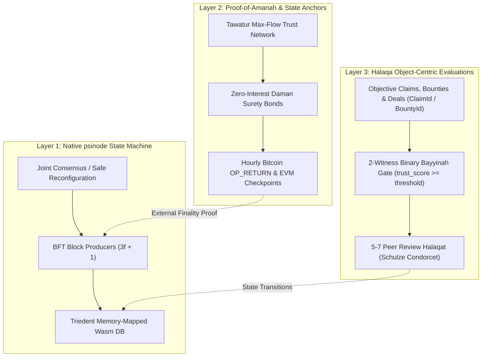
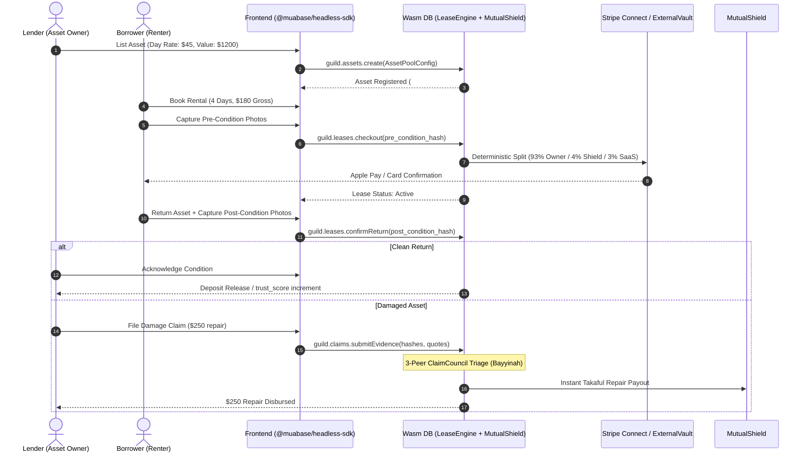

# Muabase Architectural Specification: Protocols, Fiqh Invariants, & Headless Commerce

**Status:** Normative Specification & Technical Blueprint  
**Version:** 1.0.0-rc1  
**Target Runtime:** `psibase` / `Triedent` Wasm-in-Database Virtual Machine  
**Regulatory Profile:** NYC BitLicense (`23 NYCRR § 200.2(q)`) Safe Harbor / US Uniform Commercial Code (UCC Article 12)

---

## 1. Executive Summary & Foundational Tenets

Muabase is a decentralized, serverless operating system tailored for Real-World Asset (RWA) syndication, Family Office capital governance, high-trust Peer-to-Peer (P2P) lending/rental marketplaces, and B2B trade cooperatives. 

Built as a specialized runtime on top of the Psibase Wasm-in-Database architecture, Muabase executes all business logic, index queries, and access controls within deterministic WebAssembly micro-services running directly over memory-mapped Trie storage (`Triedent`). It delivers microsecond query latencies and reactive event streams comparable to SpacetimeDB, while executing on an asynchronous Byzantine Fault Tolerant (BFT) state machine.

Crucially, Muabase enforces the mathematical invariants of classical Islamic commercial jurisprudence (*Fiqh al-Mu‘amalat*) at the state-transition level without requiring specialized religious terminology in the primary code primitives. All Wasm services, data tables, and actions use neutral, institutional identifiers while supporting dynamic dual-locale presentation.

---

## 2. Dual-Locale Terminology Specification

To accommodate both traditional commercial syndicates (Manhattan family offices, commercial fleet co-ops, fashion rental platforms) and faith-based ethical financial institutions, Muabase features a protocol-native dual-locale translation layer exposed via `packages/user/Branding`.

### 2.1 Terminology Mapping Matrix

| Canonical Code Identifier | Institutional Locale (`"institutional"`) | Jurisprudential Locale (`"muamalat"`) | Classical Legal Basis & Jurisprudential Invariant |
| :--- | :--- | :--- | :--- |
| `asset_pool` | Asset Token Series / Private LLC | *Sukuk al-Qirad / Musharakah* | Fractional co-ownership of real physical assets (*A'yan*) with shared profit and liability. |
| `lease` | Fixed Lease / P2P Rental | *Ijarah al-A‘yan wa al-Manafi‘* | Separation of asset ownership from temporary right-of-use (*Manfa‘ah*). |
| `equity_lease` | Progressive Lease-to-Own / Equity Lease | *Musharakah Mutanaqisah* | Gradual transfer of fractional asset equity alongside decreasing rental installments. |
| `mutual_shield` | Mutual Protection Reserve Pool | *Takaful (Tabarru‘ & Ta‘awun)* | Non-profit risk pooling based on gratuitous contribution (*Tabarru‘*) with pro-rata surplus return. |
| `claim_council` | Peer Triage Committee | *Majlis al-Tahkim & Shura* | Impartial arbitration by qualified, reliable peers (*Hakam*) based on tangible evidence (*Bayyinah*). |
| `evals` | Objective Bounty / Proposal Ranking | *Ju‘alah & Halaqa* | Performance-based compensation for verified work items, ranked via objective Condorcet criteria. |
| `endowment_policy` | Trust Principal Preservation Lock | *Hifz Asl al-Waqf* | Strict preservation of principal corpus (*Asl*) while allowing only productive yield (*Manfa‘ah*) to flow. |
| `priority_window` | Co-Owner Right of First Refusal | *Haqq al-Shuf‘ah* | Mandatory exclusive pre-emption window for existing fractional co-owners before external offering. |
| `charity_sink` | Public Endowment Charity Sink | *Masraf al-Sadaqah* | Absolute zero-creditor-enrichment rule: punitive late fees are routed to charitable public utility. |
| `credit_clear` | Multilateral Invoice Netting | *Muqassah* | Debt set-off between reciprocal trading partners to extinguish obligations without cash transfers. |
| `liquidity_bridge` | Earned-Respect Liquidity Bridge | *Wajahah & Hawalah* | Novation and debt assignment backed by commercial goodwill, reputation (*Wajahah*), and collateral. |
| `trust_score` | Reliability & Audit Score | *‘Adalah* | Non-transferable track record of probity, contract fulfillment, and truthful witness testimony. |
| `domain_badge` | Domain Competence Credential | *Ikhtisas* | Soulbound domain capability verification (e.g. textile inspection, real estate appraisal). |
| `tangible_ratio` | Tangible Asset Backing Ratio | *Nisbat al-‘Ayn al-Haqiqiyyah* | Mathematical floor enforcing >= 51% tangible asset/usufruct backing to prevent naked debt trading (Wasm: `tangible_ratio_bps`). |
| `evidence_gate` | Dual-Witness Evidentiary Gate | *Bayyinah (Dual Proof / Attestation)* | 2-witness quorum verification of physical evidence digests (receipt hashes, condition photos) prior to escrow or claim release. |
| `external_vault` | Non-Custodial Multi-Chain Splits | *Amanah Ghayr Hiyaziyyah (Trustee Escrow)* | 0-key client-side execution on Stripe Connect, EVM Safe, and Bitcoin Taproot Miniscript, eliminating platform custody liability. |
| `guild_pod` | Cooperative Pod & Review Circle | *Halaqat al-Tijarah / al-Shura* | Autonomous 5-7 peer governance pods operating consensus without centralized managerial capture. |

---

## 3. The 3-Layer Consensus & Governance Architecture

Muabase establishes consensus and governance through a three-layer decoupled architecture:

### 3.1 Layer 1: Native `psinode` BFT + Joint Consensus
- Operates a high-throughput, pipelined $3f + 1$ Byzantine Fault Tolerant consensus engine with instant 1-block optimistic confirmation.
- Uses **Joint Consensus** for deterministic validator set reconfiguration without downtime.
- State transactions execute directly in Wasm against memory-mapped Trie storage (`Triedent`), yielding sub-millisecond execution times and deterministic gas/CPU accounting.

### 3.2 Layer 2: Proof-of-Amanah (*Tawatur*) & External State Anchors
- **Sybil Resistance without Volatile Tokens:** Rather than relying on speculative Proof-of-Stake token holdings, network participation and validator weight are anchored in **Proof-of-Amanah**:
  1. *Tawatur Trust Flow:* Continuous maximum-flow computation over a web of trust formed by mutual non-interest surety endorsements (*Daman*).
  2. *Surety Capital Reserves:* Validators post capital in locked non-custodial vaults (`ExternalVault`), subject to automatic slashing upon cryptographic equivocation.
  3. *Cross-Chain State Anchoring:* Every 3,600 blocks (1 hour), the state-root checksum is committed into the Bitcoin blockchain via `OP_RETURN` transactions and into major EVM L2s via `Producers::recordExternalAnchor`, securing immutability against long-range reorganization.

### 3.3 Layer 3: *Halaqa* Object-Centric Evaluations
- **Strict Deprecation of Social Credit / People-Ranking:** Traditional popularity-contest mechanisms (e.g. `Fractals`) are completely disabled. Human beings are never ranked.
- **Objective Work Evaluation:** The `Evaluations` and `Subgroups` packages are exclusively configured to rank-order **discrete, auditable objects**:
  - `DamageClaim`: Physical asset damage assessment with photo evidence hashes and quotes.
  - `BountySubmission`: Verifiable open-source software, legal documentation, or operational milestone delivery (*Ju‘alah*).
  - `RwaDealProposal`: Structured asset syndication terms and appraisal validations.
- Subgroups operate as **5-to-7 peer review committees (*Halaqat*)** utilizing Condorcet (Schulze method) voting algorithms to establish consensus on claim validity and payout tiers.

---

## 4. Formal Jurisprudential & Mathematical Invariants

### 4.1 Zero-*Riba* Late-Fee Routing & Charity Sink Invariant

**Jurisprudential Constraint:** Under the consensus of Islamic commercial jurisprudence (AAOIFI Shariah Standard No. 3 on Default in Payment, Standard No. 8 on Ijarah), any financial penalty imposed on a delinquent debtor or lessee cannot accrue as income to the creditor or lessor. Any such gain constitutes prohibited usury (*Riba al-Jahiliyyah*). However, to prevent moral hazard and intentional delay by solvent debtors (*Matl al-Ghaniyy*), a financial deterrent may be levied, provided 100% of the punitive surplus is transferred to charitable causes.

**Mathematical Definition:**
Let $P_{\text{total}}$ be the total late penalty levied on a delinquent account:
$$P_{\text{total}} = C_{\text{actual}} + S_{\text{deterrent}}$$
where:
- $C_{\text{actual}}$ is the verifiable, documented administrative and direct economic cost caused by the delay (e.g., third-party storage fees, rebooking expenses, direct inspection).
- $S_{\text{deterrent}}$ is the punitive deterrence surcharge specified in the lease contract.

**State Transition Invariant:**
$$\Delta \text{Balance}(\text{Lessor}) \le C_{\text{actual}}$$
$$\Delta \text{Balance}(\text{CharitySink}) = S_{\text{deterrent}}$$
$$\forall \text{ transaction } t, \quad \frac{\partial \text{Balance}(\text{Lessor})}{\partial S_{\text{deterrent}}} = 0$$

Inside `packages/user/LeaseEngine` and `packages/user/TokenStream`, this invariant is enforced at the WebAssembly level: any transaction that attempts to route $S_{\text{deterrent}}$ to any account other than the designated `charity_sink` vault (Wasm state field: `charity_sink_account`) immediately asserts failure and aborts state execution.

### 4.2 Binary *Bayyinah* (Dual-Witness Evidentiary Gate)

**Jurisprudential Constraint:** No property claim, asset issuance, or escrow release can be executed based solely on unilateral assertion. In accordance with the Quranic injunction (Al-Baqarah 2:282) and classical rules of judicial evidence (*Adab al-Qadi*), claims require confirmation by at least two competent, upright witnesses (*Shahidayn ‘Adlayn*).

**Mathematical Definition:**
Let an evidentiary submission $E$ consist of a cryptographic digest $H(M)$ where $M$ is the canonical Ricardian metadata (e.g. condition photos, repair invoices, bill of lading).
For $E$ to unlock state execution in `StagedTx` or `ClaimCouncil`:
$$\text{WitnessSet}(E) = \{ w_i \in \text{Accounts} \mid \text{VerifySig}(w_i, H(M)) = \text{true} \}$$
$$\forall w_i \in \text{WitnessSet}(E): \quad \text{trust\_score}(w_i) \ge \tau_{\text{trust}} \quad \land \quad \text{domain}(E) \in \text{domain\_badge}(w_i)$$
$$\text{Status}(E) = \begin{cases} \text{Approved}, & \text{if } |\text{WitnessSet}(E)| \ge 2 \\ \text{PendingWitnessQuorum}, & \text{otherwise} \end{cases}$$
*(Underlying service contracts record these in `packages/system/Credentials` via `AdalahScore` and `IkhtisasTag`).*

### 4.3 Tangible Asset Floor & Secondary Market Debt Trading (*Bay‘ al-Dayn*)

**Jurisprudential Constraint:** Trading a debt obligation for another debt or currency (*Bay‘ al-Dayn*) at anything other than exact face value is strictly prohibited, as it collapses into interest-bearing discounting. However, when a financial security represents a blended pool of assets, secondary trading at market-determined prices (above or below par) is permissible **if and only if** tangible assets (*A‘yan*) and usufruct rights (*Manafi‘*) constitute the predominant share of the underlying asset base (established by the OIC Fiqh Academy and AAOIFI as a minimum threshold of 51%).

**Mathematical Definition:**
Let an RWA token series $S$ have total asset valuation $V(S)$, partitioned into:
$$V(S) = V_{\text{tangible}} + V_{\text{receivables}} + V_{\text{cash}}$$
The canonical `tangible_ratio` in basis points (`tangible_ratio_bps`) is defined as:
$$\text{tangible\_ratio} = \left\lfloor \frac{V_{\text{tangible}} + V_{\text{usufruct}}}{V(S)} \times 10,000 \right\rfloor$$

**Order Book Enforcement in `TokenSwap`:**
$$\text{AllowTrade}(P_{\text{order}}, P_{\text{par}}) = \begin{cases} \text{true}, & \text{if } \text{tangible\_ratio} \ge 5100 \\ \text{true}, & \text{if } \text{tangible\_ratio} < 5100 \ \land \ P_{\text{order}} = P_{\text{par}} \\ \text{false}, & \text{if } \text{tangible\_ratio} < 5100 \ \land \ P_{\text{order}} \ne P_{\text{par}} \end{cases}$$

Any limit order or market swap in `TokenSwap` that deviates from $P_{\text{par}}$ when $\text{tangible\_ratio} < 5100$ is rejected by the service transaction hook.

### 4.4 Co-Owner Right of First Refusal (*Haqq al-Shuf‘ah*)

**Jurisprudential Constraint:** When co-owners hold undivided shares (*Musha‘*) in a physical property or partnership, no co-owner may sell their fractional share to a third-party stranger without first offering it to their fellow co-owners at the identical price and terms.

**State Machine Implementation:**
When a fractional co-owner lists $N$ units of `TokenId` in `TokenSwap` at timestamp $T_{\text{list}}$:
1. An exclusive pre-emption window (`priority_window`, contract field `rofr_window_sec`) is initialized:
   $$W_{\text{priority}} = [T_{\text{list}}, \; T_{\text{list}} + \text{priority\_window})$$
2. For any trade fill attempt at timestamp $t$:
   $$\text{CanFill}(Buyer, t) = \begin{cases} \text{true}, & \text{if } t \ge T_{\text{list}} + \text{priority\_window} \\ \text{true}, & \text{if } t < T_{\text{list}} + \text{priority\_window} \ \land \ \text{Balance}(Buyer, \text{TokenId}) > 0 \\ \text{false}, & \text{otherwise} \end{cases}$$

---

## 5. The Inter-Chain `Wajahah-Hawalah` Liquidity Bridge

In trade credit networks and inter-node settlement, participants frequently need cross-chain purchasing power without routing through volatile crypto exchanges or custodial bridges. Muabase implements the **`Wajahah-Hawalah` Bridge**, deriving synthetic credit lines from earned commercial reputation (*Wajahah*) and locked endowment reserves (*Waqf*).

### 5.1 The Mathematical Credit Limit Formula

The bilateral credit limit $L_{A \to B}$ extended from Node $B$ to Node $A$ across independent network clusters is given by:

$$L_{A \to B} = \min \left( \alpha \cdot V_{\text{settled}}(A)_{90\text{d}} \cdot (1 - D_A)^k, \; \beta \cdot R_{\text{Waqf}}(A) \right)$$

Where:
- $V_{\text{settled}}(A)_{90\text{d}}$ is the verifiable 90-day rolling aggregate volume of fully settled commercial trades executed by Node $A$.
- $D_A \in [0, 1)$ is Node $A$'s historical default/dispute rate:
  $$D_A = \frac{\sum \text{Disputed Volume}}{\sum \text{Total Volume}}$$
- $k \ge 1$ is the risk-penalty exponent (protocol default: $k = 2.0$), ensuring non-linear decay of credit lines upon the first emergence of payment disputes.
- $R_{\text{Waqf}}(A)$ is the locked, unencumbered principal capital in Node $A$'s `EndowmentGuard` vault.
- $\alpha \in (0, 1]$ is the trade volume velocity coefficient (protocol default: $\alpha = 0.25$, allowing credit up to 25% of quarterly settled trade).
- $\beta \ge 1$ is the capital reserve multiplier (protocol default: $\beta = 1.0$, requiring 100% reserve backstop).

### 5.2 Multilateral Clearing (*Muqassah*) Engine

At scheduled clearing epochs (e.g. daily at 00:00 UTC), `CreditClear` runs a deterministic maximum-flow debt cancellation algorithm across the directed graph of accounts:
1. Let $G = (V, E)$ be the directed credit graph where directed edge $(u, v)$ represents an unpaid net balance $B_{uv}$.
2. The engine identifies all directed cycles $C = (v_1, v_2, \dots, v_n, v_1)$.
3. For each cycle, the net clearing amount is:
   $$\Delta_{\text{clear}} = \min_{(u, v) \in C} B_{uv}$$
4. All obligations along cycle $C$ are simultaneously reduced by $\Delta_{\text{clear}}$, extinguishing the mutual debt obligations without requiring external fiat or cryptocurrency transfers.

---

## 6. NYC BitLicense & Regulatory Compliance Architecture

Muabase is specifically architected to comply with the stringent regulatory framework of the New York State Department of Financial Services (NYDFS) and US Federal securities law.

### 6.1 Pure Software Exemption (`23 NYCRR § 200.2(q)`)

Under New York Codes, Rules and Regulations (`23 NYCRR § 200.2(q)`):
> *"Virtual Currency Business Activity does not include the development and dissemination of software in and of itself."*

Muabase achieves complete compliance under this safe harbor through four architectural guarantees:
1. **Zero Native Speculative Utility Token:** The protocol does not mint, distribute, sell, or require a native speculative gas token. Network bandwidth is allocated through computational CPU limit staking and deterministic quotas.
2. **100% Non-Custodial Architecture (`ExternalVault`):** Neither the software developers, the foundation, nor node operators ever hold, custody, manage, or maintain private keys controlling customer funds. All digital asset movements require direct cryptographic signatures from the users' client devices:
   - *Bitcoin:* Native Taproot Miniscript PSBTs (`P2TR`) signed client-side via hardware wallets or WebAuthn passkeys.
   - *Ethereum / Arbitrum / Base:* Native multi-signature transactions executed directly on user-owned `Safe` contracts.
   - *Solana:* Native `Squads` multi-party vaults.
3. **Mainstream Fiat Direct Splits (Stripe Connect):** For fiat-denominated marketplaces (such as P2P clothing rentals), payments settle directly via **Stripe Connect Custom/Express accounts**. The client generates deterministic payment intents with split recipients:
   - 93% transferred directly to the lender's bank account via Stripe destination charges.
   - 4% transferred directly to the guild's segregated mutual shield account.
   - 3% transferred to the SaaS node host.
   At no point do funds enter an intermediate custody wallet managed by the software vendor.
4. **Soulbound, Non-Tradable Reputation:** Reputation and trust metrics (`trust_score` / `domain_badge`, recorded in contracts via `AdalahScore` and `IkhtisasTag`) are stored as non-fungible, non-transferable data attributes tied immutably to user public keys. They cannot be traded, transferred, encumbered, or monetized, completely eliminating classification as an investment contract or virtual currency under the Howey and Martin Act tests.

---

## 7. Headless Commerce Architecture & Reactive SDK

The Muabase Headless Commerce SDK (`@muabase/headless-sdk`) enables rapid frontend development (Next.js, React Native, Vite) by abstracting low-level Wasm actions into reactive, type-safe hooks and service calls.

### 7.1 P2P Rental Lifecycle Example (Fashion / Equipment Lending)

---

## 8. Summary of Service Directory Structure

- `packages/system/StagedTx`: Ricardian contracts, 2-witness quorums (`witness_quorum >= 2`), multi-sig transaction pipeline.
- `packages/system/AuthDelegate`: Soulbound permissions and immutable `endowment_policy` (`EndowmentGuard`) principal locks.
- `packages/system/Credentials`: Non-transferable `trust_score` (reliability / `AdalahScore`) and `domain_badge` (competence / `IkhtisasTag`).
- `packages/system/Producers`: Consensus parameters and hourly Bitcoin/EVM L2 state-root checkpoints.
- `packages/user/Branding`: Dual-locale institutional/muamalat terminology translations and network branding.
- `packages/user/Tokens`: `asset_pool` (`RwaSeriesConfig`) metadata, investor count limits, 51% `tangible_ratio` floor enforcement.
- `packages/user/Nft`: Physical item tokenization, custody tracking, condition hashes.
- `packages/user/TokenSwap`: Zero-debt-speculation trading rules, Shuf'ah (`priority_window` / `rofr_window_sec`) exclusive windows.
- `packages/user/LeaseEngine`: General-purpose short-term `lease` rental & progressive `equity_lease` with non-profiteering `charity_sink` penalty routing.
- `packages/user/MutualShield`: `mutual_shield` protection reserve pool with annual surplus rebates.
- `packages/user/ClaimCouncil`: Rapid 3-peer damage triage (`claim_council`) and `evals` Condorcet bounty ranking.
- `packages/user/CreditClear`: Multilateral B2B invoice clearing (`credit_clear`) and `liquidity_bridge` trust limits.
- `packages/user/ExternalVault`: Non-custodial Bitcoin Taproot, EVM Safe, Solana Squads, and Stripe Connect split payloads.
- `packages/shared-ui/headless-sdk`: Reactive TypeScript SDK for frontend developers (`AssetPoolConfig`, `UsufructLease`, `MuabaseClient`).
