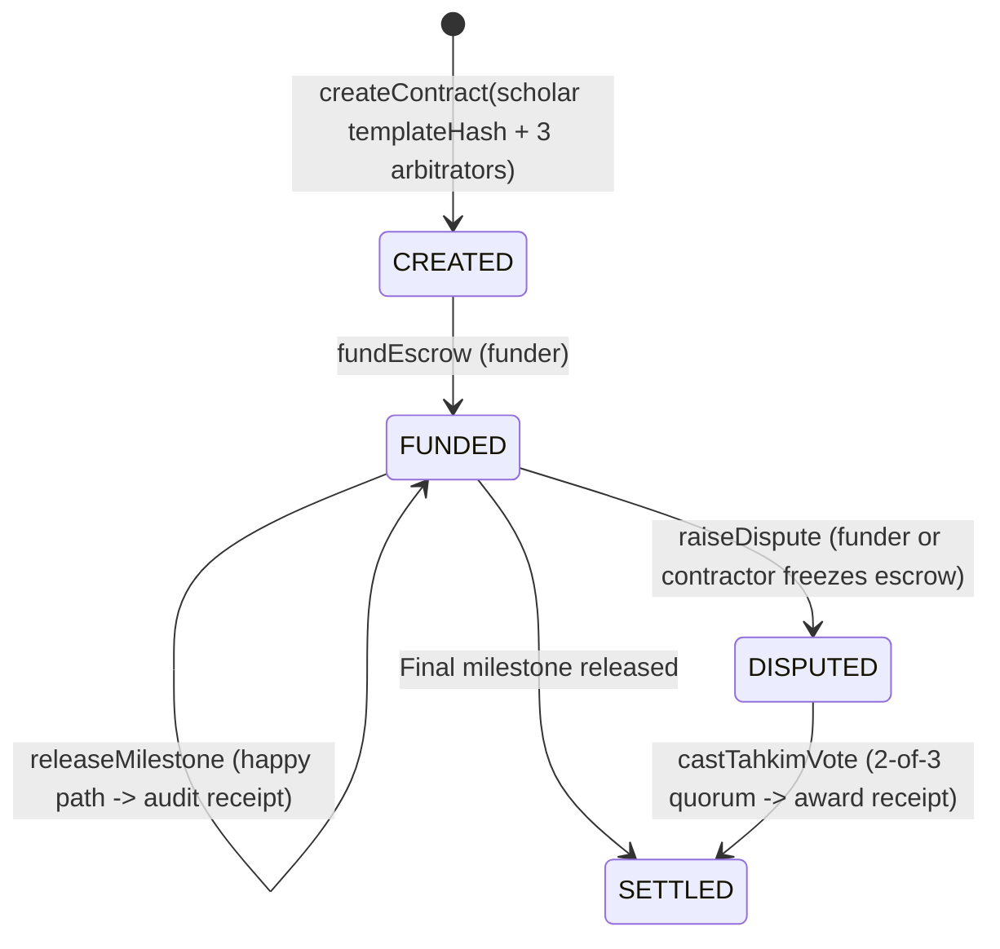

# Escrowed Commercial *Muamalat* + Native *Tahkim* Arbitration Quickstart (App 3)

**Operator & Developer Runbook — 15-Minute Local Setup**  
**Canonical Wasm Services:** `muamalat` (`packages/user/MuamalatTahkim`), `staged-tx`, `credential`, `auth-dyn`  
**Regulatory & Fiqh Alignment:** Deterministic *Istisna'* (AAOIFI No. 11) / *Mudarabah* (AAOIFI No. 13) state machine, scholar-attested template pinning, zero-plaintext B2B terms, and 2-of-3 *Tahkim* panel arbitration.

---

## 1. Contract State Machine & *Tahkim* Flow

Every commercial contract must reference an active **scholar-attested template hash** (`registerTemplate`), store only a **32-byte commitment hash** of confidential B2B specifications (`terms_commitment_hash`), and designate **3 independent arbitrators**. On a contested milestone, either party freezes the contract into `DISPUTED` (blocking unilateral releases) until a **2-of-3 *tahkim* panel** issues a binding, escrow-conserving award (`AWARD_CONTRACTOR`, `REFUND_FUNDER`, or `SPLIT`).



---

## 2. Step 1 — Spin Up Local `psinode` and Boot Services

```bash
# 1. Start local node
psinode ./muamalat-db -p tradeprod -l 127.0.0.1:8080 --host muabase.localhost

# 2. Boot system + MuamalatTahkim packages
psibase -a http://127.0.0.1:8080 boot -p tradeprod \
  Accounts AuthSig AuthDyn Credentials StagedTx Events Tokens MuamalatTahkim Producers
```

Create the scholar, commercial counterparties, and 3-member *tahkim* arbitration panel (pass `-k <pubkey.pem>` or `-i` for local keyless testing):

```bash
psibase -a http://127.0.0.1:8080 create scholar -k <SCHOLAR_PUBKEY_PEM>
psibase -a http://127.0.0.1:8080 create buyer   -k <BUYER_PUBKEY_PEM>
psibase -a http://127.0.0.1:8080 create builder -k <BUILDER_PUBKEY_PEM>
psibase -a http://127.0.0.1:8080 create arb1    -k <ARB1_PUBKEY_PEM>
psibase -a http://127.0.0.1:8080 create arb2    -k <ARB2_PUBKEY_PEM>
psibase -a http://127.0.0.1:8080 create arb3    -k <ARB3_PUBKEY_PEM>
```

---

## 3. Step 2 — Register a Scholar-Attested *Istisna'* Contract Template

`scholar` pins the canonical SHA-256 digest of the AAOIFI Standard No. 11 *Istisna'* legal template and certificate (`register-template.json`):

```json
[
  {
    "sender": "scholar",
    "service": "muamalat",
    "method": "registerTemplate",
    "data": {
      "contract_kind": "ISTISNA",
      "template_hash": "aaaaaaaaaaaaaaaaaaaaaaaaaaaaaaaaaaaaaaaaaaaaaaaaaaaaaaaaaaaaaaaa",
      "certificate_hash": "bbbbbbbbbbbbbbbbbbbbbbbbbbbbbbbbbbbbbbbbbbbbbbbbbbbbbbbbbbbbbbbb",
      "standard_ref": "AAOIFI-11"
    }
  }
]
```

```bash
psibase -a http://127.0.0.1:8080 push register-template.json -s <SCHOLAR_KEY_PEM>
```

---

## 4. Step 3 — Lock Milestone Escrow (Zero-Plaintext B2B Terms)

Seal the private B2B statement of work off-chain via `sealSelectiveDisclosureEnvelope` (`packages/shared-ui/headless-sdk/src/privacy.ts`) granting view keys to `buyer`, `builder`, and `arb1`/`arb2`/`arb3`. Commit only `terms_commitment_hash` on-chain (`create-and-fund.json`):

```json
[
  {
    "sender": "buyer",
    "service": "muamalat",
    "method": "createContract",
    "data": {
      "template_id": 1,
      "expected_template_hash": "aaaaaaaaaaaaaaaaaaaaaaaaaaaaaaaaaaaaaaaaaaaaaaaaaaaaaaaaaaaaaaaa",
      "contractor": "builder",
      "arbitrators": ["arb1", "arb2", "arb3"],
      "milestone_amounts": [40000, 60000],
      "terms_commitment_hash": "cccccccccccccccccccccccccccccccccccccccccccccccccccccccccccccccc"
    }
  },
  {
    "sender": "buyer",
    "service": "muamalat",
    "method": "fundEscrow",
    "data": { "contract_id": 1 }
  }
]
```

```bash
psibase -a http://127.0.0.1:8080 push create-and-fund.json -s <BUYER_KEY_PEM>
```

---

## 5. Step 4 — Happy Path: Release Milestone 1

When Milestone 1 (`40000` minor units) is delivered and inspected, `buyer` releases it against a 32-byte inspection evidence hash (`release-m1.json`):

```json
[
  {
    "sender": "buyer",
    "service": "muamalat",
    "method": "releaseMilestone",
    "data": {
      "contract_id": 1,
      "milestone_evidence_hash": "0101010101010101010101010101010101010101010101010101010101010101"
    }
  }
]
```

```bash
psibase -a http://127.0.0.1:8080 push release-m1.json -s <BUYER_KEY_PEM>
```

---

## 6. Step 5 — Contested Path: Freeze in Dispute & Resolve via 2-of-3 *Tahkim* Panel

Suppose Milestone 2 (`60000` remaining in escrow) is contested due to partial delivery delay:

1. **Freeze contract into `DISPUTED` (`raise-dispute.json`):**
   ```json
   [
     {
       "sender": "builder",
       "service": "muamalat",
       "method": "raiseDispute",
       "data": {
         "contract_id": 1,
         "evidence_commitment_hash": "dddddddddddddddddddddddddddddddddddddddddddddddddddddddddddddddd"
       }
     }
   ]
   ```
   While `status == "DISPUTED"`, any unilateral `releaseMilestone` call aborts with `Milestone release blocked`.

2. **Two of three independent arbitrators (`arb1`, `arb2`) review the selective-disclosure evidence bundle and vote a conserving `SPLIT` (`20000` refunded to `buyer`, `40000` awarded to `builder`; push separately or pass `-s <ARB1_KEY_PEM> -s <ARB2_KEY_PEM>`):**
   ```json
   [
     {
       "sender": "arb1",
       "service": "muamalat",
       "method": "castTahkimVote",
       "data": {
         "contract_id": 1,
         "ruling_kind": "SPLIT",
         "funder_amount": 20000,
         "contractor_amount": 40000
       }
     },
     {
       "sender": "arb2",
       "service": "muamalat",
       "method": "castTahkimVote",
       "data": {
         "contract_id": 1,
         "ruling_kind": "SPLIT",
         "funder_amount": 20000,
         "contractor_amount": 40000
       }
     }
   ]
   ```

3. **Inspect final settled state and verify the award receipt offline:**
   ```bash
   curl -s -X POST http://muamalat.muabase.localhost:8080/graphql \
     -H "Content-Type: application/json" \
     -d '{"query":"{ contract(contractId: 1) { contractId status totalEscrow releasedAmount refundedAmount lastReceiptLeafHash } dispute(contractId: 1) { contractId resolved finalRuling awardReceiptLeafHash } }"}'
   ```

   Fetch and verify an anchored `dwal_merkle` inclusion proof offline:
   ```bash
   curl -s -X POST http://127.0.0.1:8080/native/proof/state \
     -H "Content-Type: application/json" \
     -d '{"db":"service","keyHex":"<MUAMALAT_CONTRACT_KV_KEY_HEX>"}' \
     > tahkim-award-proof.json

   node tools/verify-merkle-proof.mjs tahkim-award-proof.json
   ```

---

## 7. Run Local BDD Verification Tests

```bash
cargo test --manifest-path packages/user/Cargo.toml -p muamalat-tahkim --lib
cargo check --manifest-path packages/user/Cargo.toml -p muamalat-tahkim --target wasm32-wasip1
```

## 8. Troubleshooting

- **`Scholar template attestation verification failed`:** `expected_template_hash` must match the registered active `ContractTemplate::template_hash` byte-for-byte.
- **`Arbitrators must be independent of funder and contractor`:** None of the 3 *tahkim* arbitrators may equal `buyer` or `builder`, and all 3 must be distinct.
- **`Split ruling must conserve total_escrow exactly`:** `funder_amount + contractor_amount` must equal `total_escrow - released_amount` (the remaining frozen escrow).
