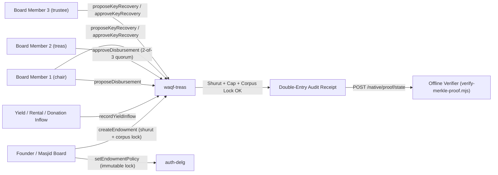

# Programmable *Waqf* & Masjid Treasury OS Quickstart (App 2)

**Operator & Developer Runbook — 15-Minute Local Setup**  
**Canonical Wasm Services:** `waqf-treas` (`packages/user/WaqfTreasury`), `auth-delg`, `auth-dyn`, `auth-rcovr`, `staged-tx`, `invite`  
**Regulatory & Fiqh Alignment:** `compliance.md` Invariant 6 (*Hifz Asl al-Waqf* — Immutable Corpus Lock, AAOIFI Standard No. 33) & Board-Quorum Stewardship.

---

## 1. Architecture & Governance Flow

A *Waqf* or Masjid endowment separates **immutable principal (*asl*)** from **distributable yield**, enforces donor stipulations (*shurut* categories + per-disbursement caps) deterministically at execution time, requires a **2-of-3 board quorum** (either natively in `waqf-treas` or via `auth-dyn` + `staged-tx`), emits `dwal_merkle`-compatible audit receipts, and supports **board-quorum treasurer key recovery** without risking single-person fund loss or lockout.



---

## 2. Step 1 — Spin Up Local `psinode` and Boot Treasury Services

```bash
# 1. Start local node
psinode ./masjid-db -p masjidprod -l 127.0.0.1:8080 --host muabase.localhost

# 2. Boot system + WaqfTreasury packages
psibase -a http://127.0.0.1:8080 boot -p masjidprod \
  Accounts AuthSig AuthDelegate AuthDyn AuthRecover StagedTx Invite Events Tokens WaqfTreasury Producers
```

Create the institutional endowment account and 3 board member accounts (plus a standby replacement seat for key-recovery simulation; pass `-k <pubkey.pem>` or `-i` for local keyless testing):

```bash
psibase -a http://127.0.0.1:8080 create masjid   -k <MASJID_PUBKEY_PEM>
psibase -a http://127.0.0.1:8080 create chair    -k <CHAIR_PUBKEY_PEM>
psibase -a http://127.0.0.1:8080 create treas    -k <TREAS_PUBKEY_PEM>
psibase -a http://127.0.0.1:8080 create trustee  -k <TRUSTEE_PUBKEY_PEM>
psibase -a http://127.0.0.1:8080 create treas2   -k <TREAS2_PUBKEY_PEM>
psibase -a http://127.0.0.1:8080 create school   -k <SCHOOL_PUBKEY_PEM>
```

> **Zero-Friction Board Onboarding (`invite`):** New board trustees or masjid staff can be onboarded without handling raw gas or funding their own accounts by issuing sponsored invites via `invite::createInvite` + `invite::createAccount` (see `doc/src/default-apps/invite.md`).

---

## 3. Step 2 — Create a Rule-Locked Endowment & Activate Immutable Corpus Lock

Create `waqf-create.json` to (a) lock the `masjid` account's principal policy in `auth-delg::setEndowmentPolicy` (immutable once activated), (b) register the endowment in `waqf-treas::createEndowment` with immutable *shurut* categories and spending cap, and (c) record initial distributable yield:

```json
[
  {
    "sender": "masjid",
    "service": "auth-delg",
    "method": "setEndowmentPolicy",
    "data": {
      "account": "masjid",
      "yield_account": "waqf-treas",
      "approved_investments": ["tokens", "waqf-treas"]
    }
  },
  {
    "sender": "masjid",
    "service": "waqf-treas",
    "method": "createEndowment",
    "data": {
      "label": "Al-Noor Masjid Scholarship Waqf",
      "corpus_principal": 1000000,
      "shurut_hash": "1111111111111111111111111111111111111111111111111111111111111111",
      "scholar_attestation_hash": "2222222222222222222222222222222222222222222222222222222222222222",
      "allowed_categories": ["scholarship", "masjid_utilities"],
      "max_single_disbursement": 30000,
      "board_members": ["chair", "treas", "trustee"],
      "quorum_threshold": 2
    }
  },
  {
    "sender": "masjid",
    "service": "waqf-treas",
    "method": "recordYieldInflow",
    "data": {
      "endowment_id": 1,
      "amount": 50000,
      "source_ref": "Q1-rental-yield-statement-2026"
    }
  }
]
```

```bash
psibase -a http://127.0.0.1:8080 push waqf-create.json -s <MASJID_KEY_PEM>
```

Verify the immutable `auth-delg` policy via GraphQL (`AuthDelegate` is a C++ service, so reflected fields use `snake_case`):

```bash
curl -s -X POST http://auth-delg.muabase.localhost:8080/graphql \
  -H "Content-Type: application/json" \
  -d '{"query":"{ endowmentPolicy(account: \"masjid\") { account distributable_yield_account approved_investment_targets is_endowment } }"}'
```

---

## 4. Step 3 — Execute a 2-of-3 Board Disbursement

### Option A: Native 2-of-3 Board Quorum (`waqf-treas`)
1. `chair` proposes a `$200.00` (`20000` cents) `"scholarship"` disbursement backed by a salted invoice commitment hash (keeping student PII off-chain):
   ```json
   [
     {
       "sender": "chair",
       "service": "waqf-treas",
       "method": "proposeDisbursement",
       "data": {
         "endowment_id": 1,
         "recipient": "school",
         "category": "scholarship",
         "amount": 20000,
         "evidence_commitment_hash": "3333333333333333333333333333333333333333333333333333333333333333"
       }
     }
   ]
   ```
2. `treas` approves proposal `1` — meeting the 2-of-3 quorum and settling atomically while preserving `corpus_principal == 1000000` and emitting `disbursementSettled`:
   ```json
   [
     {
       "sender": "treas",
       "service": "waqf-treas",
       "method": "approveDisbursement",
       "data": { "proposal_id": 1 }
     }
   ]
   ```

### Option B: `staged-tx` + `auth-dyn` Board Multisig Path
When `masjid` uses `auth-dyn` (weighted board multisig via `guilds` + `staged-tx`), board members propose and accept a staged transaction targeting `waqf-treas::executeStagedDisbursement`:
- `staged-tx::propose` wraps `{ sender: "masjid", service: "waqf-treas", method: "executeStagedDisbursement", data: { ... } }`
- `staged-tx::accept` collects 2-of-3 board signatures; once accepted, `staged-tx` executes `executeStagedDisbursement` atomically.

---

## 5. Step 4 — Verify Public Aggregate Conservation & Offline Audit Receipt

Anyone (donors, congregants, external auditors) can verify that `corpus_principal` is untouched and total yield minus disbursements balances exactly—without seeing private beneficiary invoices:

```bash
curl -s -X POST http://waqf-treas.muabase.localhost:8080/graphql \
  -H "Content-Type: application/json" \
  -d '{"query":"{ aggregateTreasury { endowmentCount totalCorpusLocked totalYieldAvailable totalDisbursed } disbursement(proposalId: 1) { proposalId category amount executed receiptLeafHash approvals } }"}'
```

Export an anchored `dwal_merkle` proof for the disbursement and verify it offline:

```bash
curl -s -X POST http://127.0.0.1:8080/native/proof/state \
  -H "Content-Type: application/json" \
  -d '{"db":"service","keyHex":"<WAQF_PROPOSAL_KV_KEY_HEX>"}' \
  > waqf-receipt-proof.json

node tools/verify-merkle-proof.mjs waqf-receipt-proof.json
```

---

## 6. Step 5 — Simulate Board-Quorum Treasurer Key Recovery

If `treas` loses their device key, the remaining 2 board members (`chair` and `trustee`) rotate the treasurer seat to `treas2` without losing access to the endowment or breaking corpus invariants (sign with both `-s <CHAIR_KEY_PEM> -s <TRUSTEE_KEY_PEM>` or push each action separately):

```json
[
  {
    "sender": "chair",
    "service": "waqf-treas",
    "method": "proposeKeyRecovery",
    "data": {
      "endowment_id": 1,
      "old_member": "treas",
      "new_member": "treas2",
      "new_pubkey_spki_hash": "4444444444444444444444444444444444444444444444444444444444444444"
    }
  },
  {
    "sender": "trustee",
    "service": "waqf-treas",
    "method": "approveKeyRecovery",
    "data": { "recovery_id": 1 }
  }
]
```

> For single-account key recovery on `treas` itself, pair with `auth-rcovr::recover(account, recovery_key)` (time-limited temporary key strictly scoped to `auth-rcovr::setKey`).

---

## 7. Run Local BDD Verification Tests

```bash
cargo test --manifest-path packages/user/Cargo.toml -p waqf-treasury --lib
cargo check --manifest-path packages/user/Cargo.toml -p waqf-treasury --target wasm32-wasip1
```

## 8. Troubleshooting

- **`Waqf Corpus Lock Violation`:** Requested `amount` exceeds `yield_balance`. Corpus principal (`corpus_principal`) can never be spent.
- **`Shurut policy check failed`:** Either `category` is not in `allowed_categories` or `amount > max_single_disbursement`.
- **`EndowmentPolicy: corpus lock is immutable once activated`:** `auth-delg::setEndowmentPolicy` intentionally blocks modifying an already-active principal lock.
