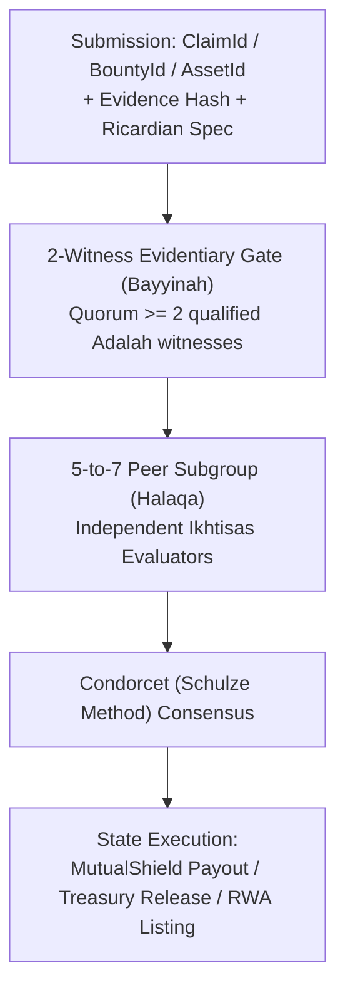

# Guilds, Subgroups, & Objective Evaluations

## 1. Architectural Purpose & Reconfiguration

In MuamalatOS, `Guilds`, `Subgroups`, and `Evaluations` have been decoupled from subjective people-ranking mechanisms (e.g., `Fractals`) and repurposed into **objective, multi-party decision engines**.

Instead of conducting popularity votes or social-credit ranking over human individuals, `Subgroups` are configured as **5-to-7 peer review committees (*Halaqat*)** that evaluate and rank-order discrete, verified digital and real-world work items:
- **`ClaimId`:** Physical damage claims, repair invoices, and condition reports submitted to `MutualShield` (*Takaful*).
- **`BountyId`:** Technical deliverables, legal structuring documents, or operational milestones (*Ju‘alah* contracts).
- **`DealProposalId` / `AssetId`:** Real-world asset syndication proposals, appraisal validations, and co-ownership terms.

---

## 2. The 5–7 Peer Review Committee Model (*Halaqa al-Tahkim*)

### 2.1 Pod Structure & Quorum Rules
1. **Size Constraint:** Each review pod (`Subgroup`) contains between **5 and 7 active evaluators**. This odd-numbered cardinality guarantees non-deadlocking consensus while maintaining high conversational intimacy and audit rigor.
2. **Domain Competence (*Ikhtisas*):** Evaluators in a triage pod must possess an active, non-transferable `IkhtisasTag` matching the claim's domain (e.g., luxury garment inspection, automotive diagnostics, commercial real estate appraisal).
3. **Probity & Trust Score (*‘Adalah*):** Evaluators must maintain an `AdalahScore >= 8000` (80th percentile reliability) recorded in `packages/system/Credentials`.

### 2.2 Objective Ranking vs. Human Ranking
- **Strict Prohibition:** No human account may ever be submitted as a candidate in an `Evaluations` poll.
- **Candidate Domain:** The set of candidates $C$ in any ranking instance consists exclusively of:
  $$C = \{ o_1, o_2, \dots, o_m \} \quad \text{where } o_i \in (\text{Claims} \cup \text{Bounties} \cup \text{AssetProposals})$$
- **Rank Ordering:** Evaluators submit pairwise preferences over candidates based on objective metrics (adherence to specification, evidence completeness, cost reasonableness). The Condorcet winner is computed deterministically by `Evaluations`.

---

## 3. Operational Workflows

### 3.1 P2P Rental Damage Triage (*Tahkim*)
1. A borrower returns a designer dress or camera gear with documented tears or sensor failure.
2. The lender files a claim with before/after photo hashes and a certified repair quote.
3. Once 2 independent witnesses confirm the evidentiary integrity (`Bayyinah`), the claim is dispatched to a 5-member `DamageTriagePod`.
4. The pod votes on the payout tier (100% repair cost, 50% shared wear-and-tear, or claim dismissed).
5. Upon quorum, `MutualShield` instantly disburses the funds from the guild's protection pool.

### 3.2 RWA Syndication & Family Office Due Diligence
1. A sponsor proposes fractionalizing a \$500,000 commercial equipment fleet.
2. The legal wrapper hash (Delaware/Wyoming Series LLC) and UCC-1 filing hash are submitted.
3. A 7-member `InvestmentCommitteePod` audits asset title, tangible asset backing ratio ($\ge 51\%$), and custodian SLA.
4. The committee approves the `RwaSeriesConfig` registration in `packages/user/Tokens`.

---

## 4. Dual-Locale Terminology Reference

| Institutional Term | Muamalat / Jurisprudence Term | Functional Role in System |
| :--- | :--- | :--- |
| **Merchant Guild** | *Niqabah / Sharikah* | Autonomous business cooperative |
| **Review Pod / Subgroup** | *Halaqa (pl. Halaqat)* | 5–7 peer evaluation committee |
| **Triage Committee** | *Majlis al-Tahkim* | Arbitration and claim dispute council |
| **Bounty Contract** | *Ju‘alah* | Unilateral reward for verified delivery |
| **Objective Evaluation** | *Taqyim al-A‘mal* | Condorcet ranking of work items |
